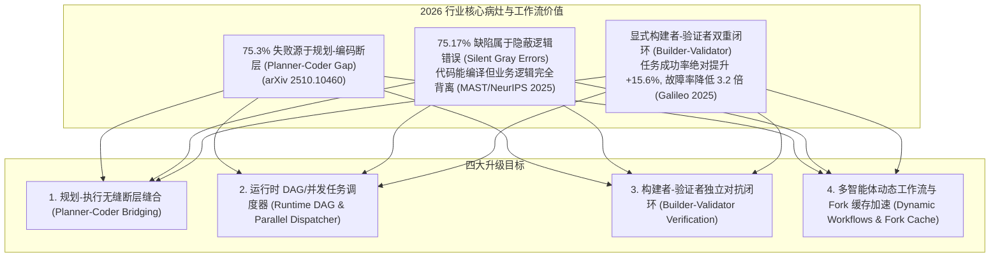
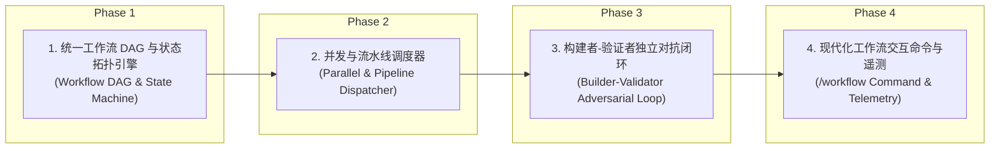

# 现代化工作流编排与 Agentic SDLC 架构升级目标 (GOAL.md)

> **版本**：2026.08.30-v2  
> **核心使命**：基于 **Oh My Pi (OMP)**、**Claude Code (2026 最新版)**、**Codex**、**DeepSeek-Harness**、**Pi / OpenCode** 五大标杆项目的工作流研究成果与 2026 行业前沿共识（UC Berkeley MAST 研究、Galileo 等），全面升级当前 Coding Agent 的工作流编排子系统。  
> **架构红线**：坚守 `AGENTS.md` 规范与 NormProof 架构约束（单文件函数 $\le 20$，严格单向无环依赖），**坚决拒绝重复造轮子**，最大化复用已有成熟基础设施（`ts-shell` 状态机、`hookDispatcher`、`microCompact`、`QuadMemory`）。

---

## 一、 核心痛点与理论指导 (Why Workflow Upgrade?)

---

## 二、 架构设计原则与代码复用策略 (Architecture & Reuse Principles)

1. **保持清晰的模块边界，坚守单一职责**：
   - 规划层（`planning/`）：只负责意图解析、任务拓扑生成与约束提取；
   - 调度层（`orchestration/`）：负责任务依赖计算、并发池控制与状态流转；
   - 验证层（`verification/` 或 `hooks/`）：负责独立对抗校验、LSP 编译检查与单测受影响分析；
   - 执行层（`runtime/`）：负责与大模型 API、工具调用与沙箱执行的原子交互。
2. **拒绝重复造轮子，深度复用已有系统资产**：
   - **复用 Hook 系统**：调度生命周期事件直接挂载在 `core/hooks/hookDispatcher.ts` 上，不再新建一套事件总线；
   - **复用内存与上下文治理**：任务执行过程中的代码片段哈希与去重直接复用 `microCompact.ts` 与 `QuadMemory`；
   - **复用命令路由器**：工作流交互指令（如 `/workflow`、`/goal`、`/loop`）统合在 `slashRouter.ts` 与 `slashCommandRegistry.ts`。
3. **消除代码冗余与死代码**：
   - 合并分散在 `workflowTaskPlanner`、`workflowExecutionCoordinator` 与 `workflowTaskPlan` 中的重叠逻辑，沉淀清晰简洁的统一执行管线。

---

## 三、 四阶段落地演进路线图 (Evolution Roadmap)

---

### Phase 1：统一工作流 DAG 与状态拓扑引擎 (Workflow DAG & State Machine)

- [ ] **1.1 定义标准工作流契约与状态流转拓扑 (`core/workflow/types.ts`)**
  - 定义 `WorkflowDefinition`、`WorkflowStage`、`WorkflowTask`、`TaskDependency` 与 `WorkflowExecutionState`；
  - 支持 5 大标准状态：`pending` $\rightarrow$ `ready` $\rightarrow$ `in_progress` $\rightarrow$ `evaluating` $\rightarrow$ `completed` / `failed`；
  - 严格保持接口简洁，支持任务间输出-输入数据映射（Artifact Passing）。
- [ ] **1.2 实现轻量有向无环图（DAG）解析与拓扑排序器 (`core/workflow/dagResolver.ts`)**
  - 基于 Kahn 算法或深度优先搜索计算无环依赖顺序；
  - 自动检测并阻断依赖循环（Cycle Detection），抛出明确的拓扑错误；
  - 计算可并行执行的独立任务批次（Ready Task Batches）。
- [ ] **1.3 结合 AST 与仓库记忆的意图上下文映射 (`core/workflow/contextInjector.ts`)**
  - 复用 `QuadMemory`（L2 仓库规则、L4 事实账本）与局部代码依赖，自动为每个 Task 注入紧凑的背景上下文；
  - 阻断“规划-编码断层（Planner-Coder Gap）”。

---

### Phase 2：并发与流水线调度器 (Parallel & Pipeline Dispatcher)

- [ ] **2.1 实现带有 Stage Barrier 的轻量 Pipeline 调度器 (`core/workflow/pipelineExecutor.ts`)**
  - 对标 Oh My Pi `pipeline(items, ...stages)`：按阶段依次推进，阶段之间设立物理屏障（Barrier），确保前一阶段全部就绪后再流转下一阶段；
  - 遇到单点失败时支持重试策略与安全降级。
- [ ] **2.2 实现受控并发池调度器 (`core/workflow/parallelDispatcher.ts`)**
  - 对标 `parallel(thunks)`：支持有上限（`maxConcurrency`，默认 4~8）的并发执行池；
  - 保持输入/输出顺序一致性，优雅处理异常传播与超时熔断。
- [ ] **2.3 动态工作流与 Prompt Cache 前缀错峰优化 (`core/workflow/cacheStaggering.ts`)**
  - 对标 2026 Claude Code `Prefix Staggering` 机制；
  - 并发派发具有相同前缀的同构子任务时，引入微小延迟（`PrefixStaggerMs`），使后置任务 100% 命中首个任务生成的 Prompt Cache 块，大幅降低 Token 开销。

---

### Phase 3：构建者-验证者独立对抗闭环 (Builder-Validator Adversarial Loop)

- [ ] **3.1 实现构建者与验证者角色解耦 (`core/workflow/builderValidator.ts`)**
  - 严格分离 **Builder Agent**（负责代码生成与修改）与 **Validator Agent**（负责根据原始验收标准进行审查）；
  - Validator 无法获取 Builder 的内部思考过程，只审查代码 Diff 与物理运行表现，杜绝“自己证明自己正确”。
- [ ] **3.2 对抗式验证反驳机制 (Adversarial Refutation Pipeline)**
  - 对标 OMP 审查体系：Reviewer 提出潜在缺陷 $\rightarrow$ Refuter 尝试反驳 $\rightarrow$ 只有无法被反驳的缺陷才判定为真实问题；
  - 自动拦截 75.17% 的 Silent Gray Errors（隐蔽逻辑缺陷）。
- [ ] **3.3 集成物理编译与单测受影响执行自愈**
  - 深度复用已有 `postMutationLspGuard.ts` 与 `affectedUnitTestRunner.ts`，验证失败时自动触发修复回路（Self-Correction Loop）。

---

### Phase 4：现代化工作流交互命令与遥测 (/workflow Command & Telemetry)

- [ ] **4.1 交付全新的 `/workflow` 交互命令 (`core/commands/workflowCommandRuntime.ts`)**
  - `/workflow run <template_or_goal>`：一键启动结构化工作流；
  - `/workflow status`：展示当前工作流 DAG 拓扑、各阶段进度条与已完成阶段耗时；
  - `/workflow pause` / `/workflow resume` / `/workflow cancel`：支持工作流热暂停与恢复。
- [ ] **4.2 注册并打通全局命令体系**
  - 在 `registry.ts`、`slashCommandRegistry.ts` 与 `cliArgs.ts` 中注册 `/workflow`（别名 `/wf`, `/pipeline`, `/dag`）。
- [ ] **4.3 编写完备单元测试套件与 CLI 物理实测**
  - 覆盖 DAG 拓扑计算、循环检测、Barrier 同步、错峰缓存、构建者-验证者对抗与命令交互；
  - 确保全仓 Vitest 测试 100% PASS，并通过 NormProof 形式化架构判定。

---

## 四、 交付验收标准 (Acceptance Criteria)

1. **架构与代码指标**：
   - 严格满足 NormProof 规则：每个模块函数数量 $\le 20$，模块间单向无环依赖；
   - TypeScript 编译 `npm run build:ts` 零错误；
   - 单元测试矩阵覆盖率 $\ge 95\%$，全部用例持续保持 PASS。
2. **功能与运行指标**：
   - DAG 调度器能正确识别并并行派发无依赖任务，遇环形依赖抛出明确错误；
   - Pipeline Barrier 能严格阻断未就绪的后置阶段；
   - Builder-Validator 机制能在真实用例中成功拦截并自动修复逻辑缺陷；
   - CLI 物理实测 `/workflow` 命令毫秒级响应，交互体验丝滑清晰。
