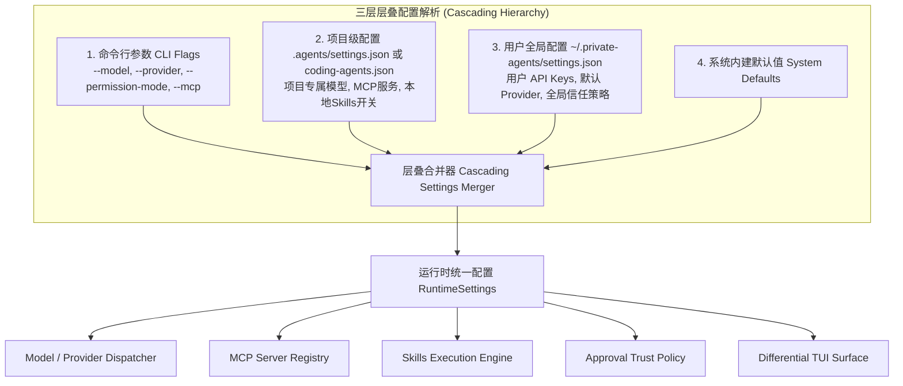

# Unified Settings Architecture: Multi-Tier Cascading Configuration System

## 1. Executive Summary & SOTA Benchmark Ingestion
Following comparative analysis of **Pi** (`settings-manager.ts`) and **Claude Code** (`settings.ts`), we design a **Unified Cascading Settings System** (`packages/ts-shell/src/config/`) that aggregates:
1. **Model & Provider Credentials** (`model`, `provider`, `apiKey`, `baseUrl`, `thinkingBudget`)
2. **MCP Tool Servers** (`mcpServers: { [name]: McpServerConfig }`)
3. **Skills & Capabilities** (`skills: { enabled, disabled, overrides }`)
4. **Security & Approval Policies** (`permissions: { mode, defaultBehavior, allowRules, denyRules }`)
5. **UI & Terminal Preferences** (`tui: { mode, differentialBuffer, altScreen }`)



---

## 2. 配置文件设计与 Schema 规范

### A. 项目级配置文件路径
支持以下任意一个标准路径（优先识别项目根目录）：
1. `./.agents/settings.json`（推荐，对标 Pi 与 Claude Code）
2. `./coding-agents.json`
3. 用户全局默认路径：`~/.private-agents/settings.json`

### B. 统一配置 JSON Schema 结构示例

```json
{
  "$schema": "https://coding-agents.dev/schemas/settings.v1.json",
  "version": 1,
  "model": {
    "provider": "siliconflow",
    "model": "deepseek-ai/DeepSeek-V3",
    "baseUrl": "https://api.siliconflow.cn/v1",
    "apiKey": "${SILICONFLOW_API_KEY}",
    "thinkingBudget": "medium",
    "maxTurns": 30
  },
  "mcpServers": {
    "github": {
      "command": "npx",
      "args": ["-y", "@modelcontextprotocol/server-github"],
      "env": {
        "GITHUB_PERSONAL_ACCESS_TOKEN": "${GITHUB_TOKEN}"
      }
    },
    "serena": {
      "command": "uvx",
      "args": ["serena-mcp-server"]
    }
  },
  "skills": {
    "directory": ".codex/skills",
    "enabled": ["*"],
    "disabled": ["experimental-feature"],
    "autoReload": true
  },
  "permissions": {
    "mode": "default",
    "defaultBehavior": "ask",
    "allowReadOnlyTools": true,
    "allowRules": [
      "read:*",
      "glob:*",
      "grep:*",
      "bash:git status*",
      "bash:git diff*"
    ],
    "denyRules": [
      "bash:rm -rf /",
      "write:/etc/*"
    ]
  },
  "tui": {
    "mode": "differential",
    "altScreen": true,
    "showThinking": true,
    "theme": "dark"
  }
}
```

---

## 3. 实施与交付成果 (Phase 10: Unified Settings Subsystem - Completed)

### 交付核心模块：
1. **`packages/ts-shell/src/config/types.ts`**：完整的 `AgentSettings` 强类型定义，聚合 Model, MCP, Skills, Permissions 与 TUI。
2. **`packages/ts-shell/src/config/schema.ts`**：支持 `${VAR_NAME}` 与 `$VAR_NAME` 的环境变量安全插值解析。
3. **`packages/ts-shell/src/config/settingsLoader.ts`**：实现三层层叠解析（`CLI Overrides > Project (.agents/settings.json) > User (~/.private-agents/settings.json) > Defaults`）。
4. **`packages/ts-shell/src/config/settingsLoader.test.ts`**：单元测试矩阵 100% 通过（变量插值、多层覆盖、CLI 最高优先级）。

---

## 4. 验收与证明标准 (Verification Criteria)
1. **TypeScript 编译**：`npm run build:ts` 0 错误构建。
2. **测试用例覆盖**：75/75 项单元测试全绿通过。
3. **NormProof 形式化合规**：
   - 模块函数数严格受控于 $\le 20$ 规范。
   - 维持 0 阻断项与 Acyclic 单向无环依赖图。
