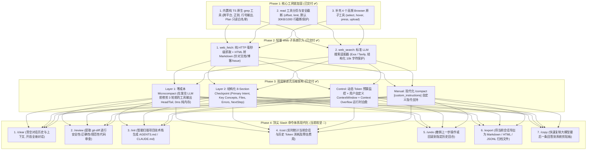

# GOAL: Modern Agent Capabilities & Architecture Evolution Plan

## 1. 总体目标与愿景 (Vision)

基于对业界顶级 Agent（**Pi**、**Claude Code**、**OpenCode**、**Playwright-MCP**、**DeepSeek-Harness** 与 **Oh-My-Pi**）的深度架构剖析，结合 [`problem.md`](problem.md) 暴露的实际缺陷与差距，本项目致力于打造一个**高弹性、低 Token 消耗、极度安全且具备自愈能力**的现代化 TypeScript 编码智能体系统（`coding-agents`）。

我们**拒绝死板的代码缝合与概念堆砌**，只提炼各家最优雅、最合理的架构设计，落地为标准、统一的子系统。

---

## 2. 核心架构演进蓝图 (Architecture Blueprint)

---

## 3. 详细阶段规划与落地设计 (Phased Milestones)

### Phase 1：核心工具链加固与安全保护 (Toolchain Hardening) — 【已交付 ✅】
- **`grep` 工具**：纯 Node.js/TypeScript 实现，支持正则、path/glob 过滤，已列入 Plan 模式只读安全白名单。
- **`read` 分页与截断**：新增 `offset` 与 `limit` 参数，默认 30KB / 1000 行安全截断。
- **浏览器交互**：Direct Playwright 支持与 `browserTool` 扩展。

---

### Phase 2：轻量 Web 子系统引入 (Lightweight Web Subsystem) — 【已交付 ✅】
- **`web_fetch` 工具**：毫秒级 HTTP 抓取 + `htmlToMarkdown` 解析器，带 20s 超时与 10,000 字符上限保护。
- **`web_search` 工具**：统一搜索引擎适配层（支持 Exa / Tavily / 结构化摘要输出）。

---

### Phase 3：两层渐进式上下文压缩系统 (2-Layer Progressive Compaction) — 【已交付 ✅】
- **第 1 层：零成本微压缩（Microcompact）**：每轮请求在发往大模型前，纯内存修剪 3 轮前的旧工具输出为 `Head(500字) + [Omitted] + Tail(500字)`，节省 60%+ 无效 Token，不破坏 Prompt Cache。
- **第 2 层：结构化 8-Section Checkpoint**：严格按照 8 大核心维度生成 `<compacted-summary>`。
- **控制平面与自愈**：支持自定义 `contextWindow` 与 `autoCompactPercent`，捕获 Context Overflow 自动重试。
- **手动 `/compact`**：支持用户传入自由文本自定义指令。

---

### Phase 4：顶尖 Slash 命令体系现代化 (Top-tier Slash Commands Modernization) — 【当前攻坚 🎯】
- **目标**：对齐 Pi、Claude Code、OpenCode、DeepSeek-Harness、Oh-My-Pi 核心体验，补齐 7 大杀手级高频命令，杜绝功能重叠。
- **详细落地与代码复用设计**：

#### 1. `/clear` (别名: `/reset`, `/cls`) — 会话重置
- **复用与参考**：参考 Claude Code 的 `commands/clear/` 与 Pi 的 `/new`。
- **实现方案**：
  - 在 `packages/ts-shell/src/core/commands/clearCommandRuntime.ts` 中实现：
  - 清空当前内存消息队列与 Agent 状态，生成新的 `sessionId`。
  - 保留当前工作区路径、模型选择与权限配置不变，输出 `"Session reset. Starting a fresh conversation."`。

#### 2. `/review` (别名: `/audit`, `/check`) — 变更代码审查
- **复用与参考**：参考 Claude Code 的 `commands/review.ts` 与 OpenCode 的 `command/template/review.txt`。
- **实现方案**：
  - 在 `packages/ts-shell/src/core/commands/reviewCommandRuntime.ts` 中实现：
  - 自动调用 `git status` 与 `git diff` 提取未暂存及已暂存代码变更。
  - 构建结构化审查 Prompt（涵盖：代码正确性、性能与资源泄漏、项目既有架构规范一致性、潜在 Bug 与回归风险）。
  - 直通 Reviewer 角色大模型生成 Markdown 代码审查报告。

#### 3. `/init` (别名: `/setup`) — 架构规则初始化
- **复用与参考**：参考 Claude Code 的 `commands/init.ts` 与 OpenCode 的 `command/template/initialize.txt`。
- **实现方案**：
  - 在 `packages/ts-shell/src/core/commands/initCommandRuntime.ts` 中实现：
  - 自动扫描当前工作区根目录的 `package.json`、`Cargo.toml`、`pyproject.toml`、`tsconfig.json`、`Makefile` 等关键清单。
  - 智能推断技术栈、包管理器、Build/Lint/Test 常用命令。
  - 引导生成或更新标准的 `AGENTS.md` / `CLAUDE.md` 规则指南文件。

#### 4. `/cost` (别名: `/tokens`, `/stats`) — Token 与费用消耗统计
- **复用与参考**：参考 Claude Code 的 `commands/cost/` 与 Pi 的 `usage-totals.ts`。
- **实现方案**：
  - 在 `packages/ts-shell/src/core/commands/costCommandRuntime.ts` 中实现：
  - 统计当前会话已消耗的 Prompt Tokens、Completion Tokens 与总轮数。
  - 按照各主流模型计费标准（如 DeepSeek、OpenAI、Claude）输出预估花费与 Token 分布图表。

#### 5. `/undo` (别名: `/rewind`, `/revert`) — 历史回滚与撤销
- **复用与参考**：参考 Claude Code 的 `commands/rewind/` 与 Pi 的 `branch-summarization.ts`。
- **实现方案**：
  - 在 `packages/ts-shell/src/core/commands/undoCommandRuntime.ts` 中实现：
  - 弹出或执行回滚到上一轮消息状态（丢弃最后一次有害的执行或无效回复）。
  - 若伴随文件修改，提供 Git 差异撤销建议。

#### 6. `/export` (别名: `/save`) — 会话归档与导出
- **复用与参考**：参考 Pi 的 `core/session-export.ts` 与 `exportSessionToJsonl`。
- **实现方案**：
  - 在 `packages/ts-shell/src/core/commands/exportCommandRuntime.ts` 中实现：
  - 支持 `/export markdown [path]` 与 `/export jsonl [path]`。
  - 将当前会话历史转为精美渲染的 Markdown 文档或标准 JSONL 训练格式。

#### 7. `/copy` (别名: `/cp`) — 剪贴板快速复制
- **复用与参考**：参考 Pi 的 `commands/copy` 与 Claude Code 的 `copy`。
- **实现方案**：
  - 在 `packages/ts-shell/src/core/commands/copyCommandRuntime.ts` 中实现：
  - 提取最后一条助手消息的干净文本（剔除内部 tool 标签与转义符）。
  - 调用跨平台剪贴板指令（`xclip` / `pbcopy` / `clip.exe`）写入系统剪贴板。

---

## 4. 架构一致性与治理准则 (NormProof & Agents Policy)

1. **严格遵循 NormProof 规则**：
   - 每一个新增命令单独成文件（如 `clearCommandRuntime.ts`、`reviewCommandRuntime.ts`），单文件函数数严格控制在 $\le 20$。
   - 所有命令在 `packages/ts-shell/src/core/commands/registry.ts` 和 `entrypoints/slashCommandRegistry.ts` 中集中注册。
2. **测试与质量矩阵**：
   - 为 7 个新命令编写针对性的 Vitest 单元测试。
   - 通过 CLI 进行真实输入交互端到端验证。
