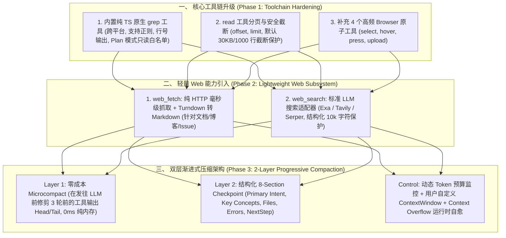

# GOAL: Modern Agent Capabilities & Architecture Evolution Plan

## 1. 总体目标与愿景 (Vision)

基于对业界顶级 Agent（**Pi**、**Claude Code**、**OpenCode**、**Playwright-MCP** 与 **DeepSeek-Harness**）的深度架构剖析，结合 [`problem.md`](problem.md) 暴露的实际缺陷与差距，本项目致力于打造一个**高弹性、低 Token 消耗、极度安全且具备自愈能力**的现代化 TypeScript 编码智能体系统（`coding-agents`）。

我们**拒绝死板的代码缝合与概念堆砌**，只提炼各家最优雅、最合理的架构设计，落地为标准、统一的子系统。

---

## 2. 核心架构演进蓝图 (Architecture Blueprint)

---

## 3. 详细阶段规划与落地设计 (Phased Milestones)

### Phase 1：核心工具链加固与安全保护 (Toolchain Hardening)
- **目标**：解决大文件冲垮上下文、Plan 模式无法搜索代码以及复杂网页表单无法交互的痛点。
- **参考与复用方案**：
  - **`grep` 工具**：参考 `pi/packages/coding-agent/src/core/tools/grep.ts`，基于 Node.js `fs` / `readline` 或工作区文件流实现原生内存正则检索，输出格式 `file:line: content`，原生加入 Plan 模式只读白名单。
  - **`read` 分页与截断**：参考 `pi` 的 `truncate.ts`，增加 `offset`（起始行）、`limit`（读取行数），默认单次超出 30KB / 1000 行时自动截断并在末尾提示 `[File truncated: showing lines X-Y of Z. Use offset/limit to view more]`。
  - **浏览器交互补齐**：参考 `playwright-mcp`，在现有 `browserTool.ts` 基础上扩展 `browser.select`（操作下拉框）、`browser.hover`（悬停浮层）、`browser.press`（按键模拟）、`browser.upload`（文件上传）。
- **验收标准**：
  - 单元测试验证 `grep` 正则检索与过滤功能。
  - 读取超过 2000 行的文件时自动触发安全截断，且支持通过 `offset`/`limit` 分页翻页。
  - 浏览器工具能成功完成 `<select>` 选择与按键模拟。

---

### Phase 2：轻量 Web 子系统引入 (Lightweight Web Subsystem)
- **目标**：杜绝“查个文档就拉起整个 Playwright 浏览器”的资源浪费，提供毫秒级、省 Token 的联网搜索与抓取。
- **参考与复用方案**：
  - **`web_fetch` 工具**：
    - 参考 `opencode/packages/opencode/src/tool/webfetch.ts` 与 `deepseek-harness/packages/web/web-fetch-http/`。
    - 采用 Node.js 原生 `fetch` 发起 GET 请求（带主流浏览器 User-Agent），配合 `turndown` 库将 HTML 正文清洗并转换为标准 Markdown。
    - 内置 50KB / 10,000 字符限制，专门用于快速阅读技术文档、博客和 GitHub Issue。
  - **`web_search` 工具**：
    - 参考 `opencode/packages/opencode/src/tool/websearch.ts` 与 `deepseek-harness/packages/web/web-search-exa/`。
    - 实现统一的搜索适配层，优先支持 Exa AI（`https://api.exa.ai/search`）与通用的 Search Provider，返回结构化 `{ title, url, snippet }` 列表。
- **验收标准**：
  - 能够毫秒级抓取公开 URL 并返回清晰的 Markdown 文本。
  - 配置 API Key 后能够正常发起 `web_search` 并返回限制在 10k 字符以内的结构化结果。

---

### Phase 3：两层渐进式上下文压缩系统 (2-Layer Progressive Compaction)
- **目标**：彻底废除静态 12 轮压缩，实现日常 0 成本降噪与撑满时的无损结构化断点总结，支持用户自定义 Context Window 与 Overflow 自动恢复。
- **参考与复用方案**：
  - **第 1 层：零成本微压缩（Microcompact / Tool Result Pruner）**：
    - 参考 `claude-code` 的 `microCompact.ts` 与 `deepseek-harness` 的 `compaction-tool-result-pruner`。
    - 在每次向模型发起 API 请求前，自动检查消息列表：保留最近 3 轮完整工具输出；对 3 轮之前的旧工具调用（如海量 bash 日志或 read 输出）进行原地裁剪为 `Head(500字) + [Omitted N lines] + Tail(500字)`。
    - **收益**：0ms 额外开销，节省 60%+ 无效 Token，且不破坏 Prompt Cache。
  - **第 2 层：结构化 8-Section Checkpoint (Full Compact)**：
    - 参考 `deepseek-harness` 的 `compaction-basic/summarizer.ts` 与 `pi` 的 `fileOps` 提取。
    - 提示词严格遵循 8 大结构（`Primary Request and Intent`、`Key Technical Concepts`、`Files and Code`、`Errors and Fixes`、`Pending Jobs`、`Current Work`、`Next Step`、`Critical Context`），输出标准的 `<compacted-summary>`。
    - 写入 `compact_boundary`，历史消息归档入磁盘，工作内存仅保留 Checkpoint。
  - **控制平面与自愈机制**：
    - 在 `settings.json` 与 CLI 中支持 `compaction.contextWindow`、`compaction.autoCompactPercent`（默认 80%）与 `compaction.reserveTokens`（默认 8000）。
    - 参考 `pi` 的 `_checkCompaction`，在运行时拦截 Provider 返回的 `context_length_exceeded` / `HTTP 400` 错误，自动丢弃报错帧 $\rightarrow$ 紧急触发 Full Compact $\rightarrow$ 自动重试当前轮。
- **验收标准**：
  - 编写端到端长会话测试：验证第 1 层 Microcompact 能够自动缩减旧工具日志。
  - 验证达到自定义 Token 水位线（或手动输入 `/compact`）时生成合规的 8-Section `<compacted-summary>`。
  - 模拟 Context Overflow 异常时，系统自动完成压缩并恢复对话，用户无感。

---

## 4. 架构一致性与治理准则 (NormProof & Agents Policy)

1. **严格遵循 NormProof 规则**：
   - 所有新建子模块（如 `grep/`、`web/`、`compaction/`）必须职责单一，单文件函数数严格遵守 $\le 20$ 的架构上限。
   - 依赖关系单向无环，入口处暴露简洁的 Facade。
2. **证据与真实性原则**：
   - 所有新增工具必须具有严格的 JSON Schema 属性定义与返回值契约。
   - 所有功能必须经过单元测试与真实 CLI 运行验证后方可交付。
