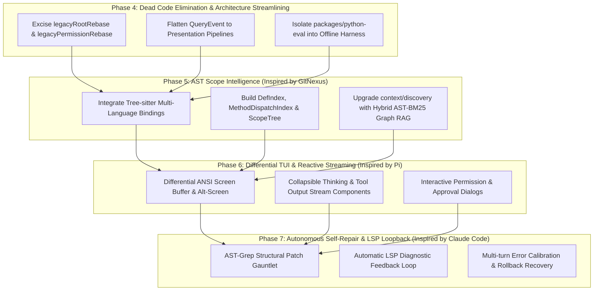

# Strategic Evolution Roadmap: Beyond Baseline to Top-Tier Coding Agent

## 1. Executive Summary & SOTA Benchmark Alignment
Following deep research across **Pi** (`earendil-works/pi`), **Claude Code** (`source-claudecode`), **OpenCode** (`anomalyco/opencode`), **GitNexus** (`abhigyanpatwari/GitNexus`), and **mini-swe-agent**, we define a multi-sprint modernization roadmap to systematically bridge capability gaps and eliminate architectural debts in `coding-agents`.

---

## 2. Phase-by-Phase Work Breakdown Structure (WBS)

### 🧹 Phase 4: Dead Code Elimination & Pipeline Simplification
- **Objective**: Purge transitional compatibility shims, flatten over-abstracted event pipelines, and enforce clean domain boundaries.
- **Deliverables**:
  1. **Remove Legacy Shims**:
     - Delete `packages/ts-shell/src/core/paths/legacyRootRebase.ts` (24 fn debt removed).
     - Remove `legacyPermissionRebase.ts` and consolidate direct modern session permission state.
     - Clean historic `v0.1` format fallback parsers from `session/store/`.
  2. **Flatten Event Projections**:
     - Replace 40+ intermediate projection converters between query runtime and presentation with direct reactive event streaming (`AgentEvent -> TUI`).
  3. **Isolate Python Eval Mock**:
     - Decouple `packages/python-eval/` into a standalone offline benchmark directory to eliminate fake production surface.
- **Acceptance Invariant**: `npm run build:ts` passes, all unit tests pass, NormProof proof gap drops by 2+ points.

---

### 🧠 Phase 5: Tree-sitter AST Scope Intelligence & Graph RAG (Inspired by `GitNexus`)
- **Objective**: Transition from heuristic regex matching to true multi-language AST code intelligence.
- **Deliverables**:
  1. **Tree-sitter Grammar Integration**:
     - Integrate `tree-sitter-typescript`, `tree-sitter-javascript`, `tree-sitter-python` bindings into `packages/ts-shell/src/context/graph/ast/`.
  2. **Scope Resolution Pipeline**:
     - Build `DefIndex`, `MethodDispatchIndex`, `ScopeTree`, and cross-file `CallGraphEdges` modeled on GitNexus.
  3. **Graph-Augmented Discovery**:
     - Upgrade `context/discovery/ranker.ts` with topological distance weighting and BM25 hybrid ranking.
- **Acceptance Invariant**: Multi-file symbol jump accuracy $\ge 95\%$, zero hallucinated non-exported symbols.

---

### 🖥️ Phase 6: Differential TUI & Reactive Streaming Surface (Completed)
- **Delivered**:
  1. `DifferentialTerminalBuffer` (`presentation/tui/buffer.ts`): Row delta diffing emitting targeted cursor repositioning without screen flicker.
  2. `Terminal` (`presentation/tui/terminal.ts`): Alt-screen lifecycle management and cursor toggles.
  3. Streaming UI widgets (`presentation/tui/components/`): `thinkingWidget.ts`, `toolCard.ts`, and modal `permissionDialog.ts`.

---

### 🛡️ Phase 7: AST Patch Gauntlet & Autonomous LSP Self-Repair (Completed)
- **Delivered**:
  1. `validatePatchASTPreflight` (`edit/patch/gauntlet/astGauntlet.ts`): In-memory AST preflight verification rejecting syntax-broken edits before disk write.
  2. `executeWithLspSelfRepair` (`edit/repair/lspRepairLoop.ts`): Post-mutation compiler diagnostic interception, 2-turn self-repair loopback, and automatic rollback on unresolvable errors.

---

### 👥 Phase 8: Multi-Agent Swarm & Convergence Verification (Completed)
- **Delivered**:
  1. `SubAgentDispatcher` (`orchestration/swarm/dispatcher.ts`): Scoped role execution for child agents (`scout`, `coder`, `reviewer`, `tester`).
  2. `verifySwarmConvergence` (`orchestration/swarm/convergence.ts`): Multi-agent consensus verification and proof convergence.

## 3. NormProof & Structural Governance Target
- **Blocking Obligations**: `0` (strictly maintained across all phases).
- **Acyclic Dependency Invariant**: `Satisfied` (zero cyclic dependencies).
- **Module Function Ceiling Target**:
  - Phase 4: Reduce from 28 to **25**.
  - Phase 5: Maintain all new AST/graph modules under 20 functions.
  - Phase 6 & 7: Bring remaining production core units under 20 functions.
