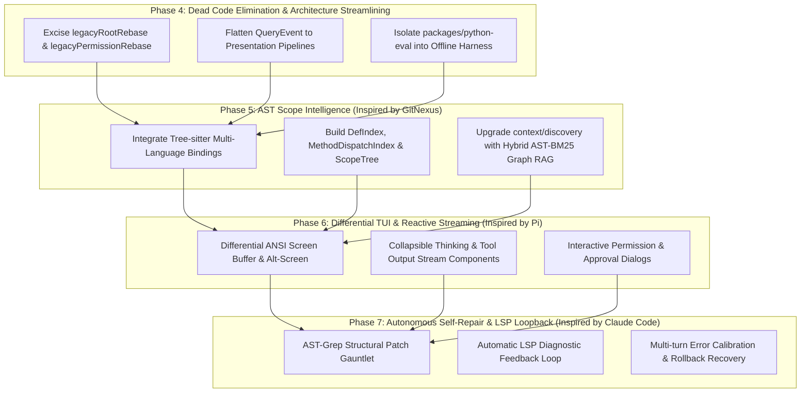

# Strategic Evolution Roadmap: Beyond Baseline to Top-Tier Coding Agent

## 1. Executive Summary & SOTA Benchmark Alignment
Following deep research across **Pi** (`earendil-works/pi`), **Claude Code** (`source-claudecode`), **OpenCode** (`anomalyco/opencode`), **GitNexus** (`abhigyanpatwari/GitNexus`), and **mini-swe-agent**, we define a multi-sprint modernization roadmap to systematically bridge capability gaps and eliminate architectural debts in `coding-agents`.

---

## 2. Phase-by-Phase Work Breakdown Structure (WBS)

### 🧹 Phase 4: Dead Code Elimination & Pipeline Simplification
- **Objective**: Purge transitional compatibility shims, flatten over-abstracted event pipelines, and enforce clean domain boundaries.
- **Deliverables**:
  1. **Remove Legacy Shims**:
     - Delete `packages/ts-shell/src/core/paths/legacyRootRebase.ts` (24 fn debt removed).
     - Remove `legacyPermissionRebase.ts` and consolidate direct modern session permission state.
     - Clean historic `v0.1` format fallback parsers from `session/store/`.
  2. **Flatten Event Projections**:
     - Replace 40+ intermediate projection converters between query runtime and presentation with direct reactive event streaming (`AgentEvent -> TUI`).
  3. **Isolate Python Eval Mock**:
     - Decouple `packages/python-eval/` into a standalone offline benchmark directory to eliminate fake production surface.
- **Acceptance Invariant**: `npm run build:ts` passes, all unit tests pass, NormProof proof gap drops by 2+ points.

---

### 🧠 Phase 5: Tree-sitter AST Scope Intelligence & Graph RAG (Inspired by `GitNexus`)
- **Objective**: Transition from heuristic regex matching to true multi-language AST code intelligence.
- **Deliverables**:
  1. **Tree-sitter Grammar Integration**:
     - Integrate `tree-sitter-typescript`, `tree-sitter-javascript`, `tree-sitter-python` bindings into `packages/ts-shell/src/context/graph/ast/`.
  2. **Scope Resolution Pipeline**:
     - Build `DefIndex`, `MethodDispatchIndex`, `ScopeTree`, and cross-file `CallGraphEdges` modeled on GitNexus.
  3. **Graph-Augmented Discovery**:
     - Upgrade `context/discovery/ranker.ts` with topological distance weighting and BM25 hybrid ranking.
- **Acceptance Invariant**: Multi-file symbol jump accuracy $\ge 95\%$, zero hallucinated non-exported symbols.

---

### 🖥️ Phase 6: Differential TUI & Reactive Streaming Surface (Inspired by `pi`)
- **Objective**: Deliver a fluid terminal UI with real-time collapsible thinking, markdown streaming, and interactive permission prompts.
- **Deliverables**:
  1. **Differential ANSI Screen Buffer**:
     - Port Pi's `packages/tui` differential buffer (`tui.ts`) to minimize screen flicker on complex updates.
  2. **Streaming Widget Components**:
     - Implement live-updating collapsible Thinking blocks, real-time tool progress bars, and syntax-highlighted diff widgets.
  3. **Interactive Permission Prompt Dialog**:
     - Wire `approval/evaluator.ts` (`behavior === 'ask'`) to interactive keyboard prompt dialogs (`[y/n/always/never]`).
- **Acceptance Invariant**: Alt-screen rendering under 16ms per frame, seamless terminal resize handling.

---

### 🛡️ Phase 7: AST Patch Gauntlet & Autonomous LSP Self-Repair (Inspired by `Claude Code`)
- **Objective**: Eliminate syntax regressions during code generation via structural AST patch verification and automated LSP error feedback loops.
- **Deliverables**:
  1. **Structural Patch Gauntlet**:
     - Validate proposed file mutations via AST before disk write; reject invalid AST mutations preflight.
  2. **Autonomous LSP Loopback**:
     - Automatically execute LSP diagnostics on modified files post-mutation.
     - On diagnostic errors, automatically trigger model retry with compiler diagnostics attached.
  3. **Multi-Target Atomic Rollback**:
     - Integrate `fileMutationQueue` with rollback snapshots to revert entire multi-file changesets if verification fails.
- **Acceptance Invariant**: Zero malformed code writes survive to disk; automatic self-repair on syntax/type errors within $\le 2$ retry turns.

---

## 3. NormProof & Structural Governance Target
- **Blocking Obligations**: `0` (strictly maintained across all phases).
- **Acyclic Dependency Invariant**: `Satisfied` (zero cyclic dependencies).
- **Module Function Ceiling Target**:
  - Phase 4: Reduce from 28 to **25**.
  - Phase 5: Maintain all new AST/graph modules under 20 functions.
  - Phase 6 & 7: Bring remaining production core units under 20 functions.
