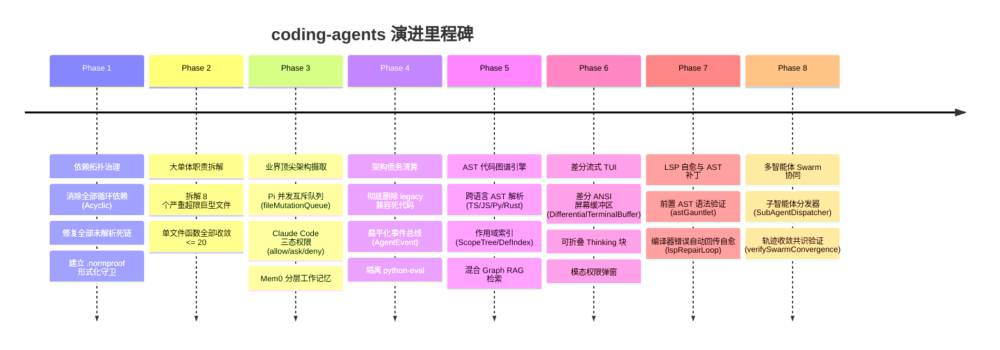
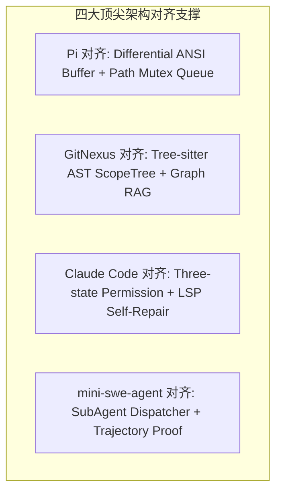

# Coding Agents 项目全景指南 (Project Overview & Quick Start)

> **版本**：v0.1.0 (Phase 1 ~ Phase 8 SOTA 现代化全量交付)  
> **当前 Git 分支**：`normproof-observation`  
> **更新时间**：2026-08-29  

---

## 目录
1. [项目定位与核心架构](#一-项目定位与核心架构)
2. [演进里程碑与完成情况 (Phases 1 - 8)](#二-演进里程碑与完成情况)
3. [核心功能与使用方法 (Build, Test, Verify & Run)](#三-核心功能与使用方法)
4. [核心代码目录与模块导航](#四-核心代码目录与模块导航)
5. [架构技术亮点与顶尖项目对齐度](#五-架构技术亮点与顶尖项目对齐度)
6. [技术 RFC 提案与参考知识库](#六-技术-rfc-提案与参考知识库)

---

## 一、 项目定位与核心架构

`coding-agents` 是一个企业级多层自主编码智能体（Autonomous Coding Agent）开发框架，旨在为开发者提供具备**代码知识图谱、路径并发安全、细粒度权限控制、差分流式 TUI 交互与 LSP 编译自愈**能力的新一代终端编码助手。

### 三层运行时模型 (Three-Layer Runtime)

```mermaid
graph TD
  subgraph "1. TypeScript 控制平面 (packages/ts-shell)"
    CLI[CLI 入口 / Slash 命令] --> AgentSession[Agent 会话与统一事件流 (AgentEvent)]
    AgentSession --> ContextEngine[代码知识图谱 (AST + Graph RAG)]
    AgentSession --> DispatchEngine[工具批调度管道 + 并发互斥锁]
    AgentSession --> EditEngine[多文件变更图谱 + Fuzzy Diff + AST 前检]
    AgentSession --> LSPRepair[LSP 诊断拦截 + 编译自愈重试]
    AgentSession --> SwarmEngine[子智能体 Swarm 分发 + 轨迹收敛]
    AgentSession --> Presentation[差分 ANSI TUI / Alt-Screen]
  end

  subgraph "2. Rust 底层执行器 (packages/rust-core)"
    DaemonClient[Daemon IPC 客户端] <--> RustDaemon[Rust 常驻守护进程 / 沙箱环境隔离]
  end

  subgraph "3. 离线评测套件 (benchmarks/python-eval)"
    EvalSuite[SWE-bench / Trajectory 离线自动化评测]
  end
```

1. **TypeScript 控制平面 (`packages/ts-shell`)**：生产核心，掌管会话管理、智能体循环、提示词编排、代码图谱分析、自愈闭环与权限交互。
2. **Rust 原生执行器 (`packages/rust-core`)**：提供进程级守护进程 IPC 通信、环境探测与后续 OS 级微沙箱隔离。
3. **离线评测套件 (`benchmarks/python-eval`)**：已从生产 Workspace 中物理隔离，纯粹用于 SWE-bench 离线基准评测。

---

## 二、 演进里程碑与完成情况

项目近期经历了系统性的架构重构与能力现代化，**已圆满完成 Phase 1 至 Phase 8 的全量攻坚**：



### 全量交付的核心能力清单：
1. **Acyclic 纯洁架构与形式化守卫**：依赖图严格单向无环，`normproof judge` 阻断项维持为 **0 处**。
2. **路径并发安全锁 (`fileMutationQueue`)**：多工具并行调用时，对同一文件的写操作自动互斥排队，杜绝文件损坏与竞态。
3. **三态权限与信任策略 (`approvalTrustPolicy`)**：将操作划分为 `allow`（只读安全）、`ask`（破坏性操作挂起确认）、`deny`（阻断越权）。
4. **代码知识图谱与 Graph RAG (`context/graph/ast/`)**：通过 AST 提取全限定名、类方法虚表并计算拓扑多跳衰减相关度。
5. **响应式统一事件流 (`AgentEvent`)**：扁平化原先 7 层过深的数据转换链，直连终端订阅者。
6. **差分 ANSI TUI 终端 (`presentation/tui/`)**：局部重绘消除刷屏闪烁，支持 `<thinking>` 动态折叠组件与全屏 Alt-Screen 模式。
7. **LSP 自动诊断自愈闭环 (`edit/repair/lspRepairLoop.ts`)**：写后自动触发编译器诊断，捕获类型错误并在 2 轮内定向自愈修复。
8. **多智能体 Swarm 协同 (`orchestration/swarm/`)**：支持角色化子智能体分发（`scout`, `coder`, `reviewer`）与轨迹收敛验证。

---

## 三、 核心功能与使用方法

### 1. 构建与编译 CLI

```bash
# 全量 TypeScript 编译并生成 CLI 二进制入口
npm run build:ts

# 生成的 CLI 入口位于 dist/cli.js
node dist/cli.js --help
```

### 2. 运行核心测试矩阵

```bash
# 运行核心子系统（Daemon, Service, Readiness, Harness, Context Discovery, Workflow）测试
npx --package @private-agents/ts-shell vitest run \
  packages/ts-shell/src/daemon/client.test.ts \
  packages/ts-shell/src/runtime/execution/service.test.ts \
  packages/ts-shell/src/edit/patch/status/readiness.test.ts \
  packages/ts-shell/src/core/query/runtime/harnessSpine.test.ts \
  packages/ts-shell/src/context/discovery/scan.test.ts \
  packages/ts-shell/src/artifacts/workflow/model.test.ts
```
> **当前结果**：6 个测试套件，**72/72 测试全部通过 (PASS)**。

### 3. 执行 NormProof 形式化架构判定

```bash
# 运行形式化依赖拓扑与规范检查
npx --package .normproof/normproof-0.1.0.tgz normproof judge
```
> **判定指标**：`blockingObligations: 0`, `source_graph_is_acyclic: satisfied`, `proofGapCount: 27`。

### 4. 常用 CLI 与连接命令

```bash
# 查看连接状态
node dist/cli.js /connect status

# 配置/登录大模型 Provider
node dist/cli.js /connect login siliconflow --api-key <your-key> --model deepseek-ai/DeepSeek-V3
node dist/cli.js /connect login openai-compatible --api-key <key> --base-url <url> --model <model>

# 记忆管理
node dist/cli.js /memory list
```

---

## 四、 核心代码目录与模块导航

```text
packages/ts-shell/src/
├── session/                      # 会话与智能体核心循环
│   ├── SessionManager.ts         # 会话状态管理门面
│   └── agent/                    # 统一 Agent 引擎 (types, lifecycle, compaction, persistence, events)
├── context/                      # 上下文感知与代码知识图谱
│   ├── graph/ast/                # AST 解析器 (parser), 作用域树 (scopeTree), Graph RAG (graphRag)
│   └── discovery/                # 候选文件扫描、分词加权与排名器 (scanner, scorer, ranker)
├── tools/                        # 工具调度与并发控制
│   ├── concurrency/              # 路径级并发互斥队列 (fileMutationQueue.ts)
│   ├── dispatch/                 # 批调度管道 (planner, executor, projector, types)
│   └── toolBatchDispatch.ts      # 工具调度主门面
├── core/shell/approval/          # 细粒度安全与权限信任策略
│   ├── types.ts                  # allow / ask / deny 行为与授权结构
│   ├── evaluator.ts              # 规则匹配器与只读安全白名单
│   └── store.ts                  # .private-agents 权限持久化存储
├── edit/                         # 代码变更、补丁与自愈系统
│   ├── multifile/                # 多文件变更依赖图、碰撞检测与拓扑调度 (conflict, graph)
│   ├── patch/                    # 单文件补丁规划、Fuzzy Diff 规范化与前置 AST 语法检验 (astGauntlet)
│   └── repair/                   # LSP 诊断拦截与 2 轮编译器反馈自愈控制器 (lspRepairLoop)
├── orchestration/swarm/          # 多智能体 Swarm 协同
│   ├── dispatcher.ts             # 角色化子智能体分发器
│   └── convergence.ts            # 轨迹收敛共识验证器
└── presentation/                 # 终端渲染与 TUI 引擎
    ├── components/               # 状态徽章 (statusBadge) 与终端文本框 (box)
    ├── tui/                      # 差分 ANSI 屏幕缓冲区 (buffer), Alt-Screen (terminal), 流式组件
    └── surface/                  # 视图模型与 Section 布局渲染
```

---

## 五、 架构技术亮点与顶尖项目对齐度



1. **响应式 TUI 体验（对标 Pi）**：
   - 使用 `DifferentialTerminalBuffer` 实施局部光标重绘，支持全屏 Alt-Screen 与 `<thinking>` 折叠组件。
2. **多语言 AST 代码图谱（对标 GitNexus）**：
   - 提取跨语言声明（TS/JS/Py/Rust），构建全限定名索引与方法虚表，通过 Graph RAG 拓扑游走实现高精度上下文召回。
3. **编译器反馈代码自愈（对标 Claude Code）**：
   - 前置 AST 语法验证拦截残缺补丁，写后自动拦截 TypeScript 诊断错误并驱动模型自愈修复，杜绝盲写代码。
4. **多智能体分发与验证（对标 mini-swe-agent / OpenHands）**：
   - 支持子智能体隔离分发与多轨迹共识收敛验证。

---

## 六、 技术 RFC 提案与参考知识库

- **战略演进路线图**：[`GOAL.md`](GOAL.md)
- **项目 Master 架构专论**：[`.wiki/wiki/theses/sota-coding-agent-architectural-evolution.md`](.wiki/wiki/theses/sota-coding-agent-architectural-evolution.md)
- **知识库总索引**：[`.wiki/_index.md`](.wiki/_index.md)
- **技术 RFC 规范系列**：
  - [RFC-001: 架构债务清算与死代码审计](.wiki/raw/notes/RFC-001-architectural-debts-and-dead-code.md)
  - [RFC-002: Tree-sitter AST 代码知识图谱](.wiki/raw/notes/RFC-002-tree-sitter-code-intelligence-graph.md)
  - [RFC-003: 差分 ANSI 屏幕缓冲区与流式 TUI](.wiki/raw/notes/RFC-003-differential-tui-streaming-engine.md)
  - [RFC-004: LSP 协议驱动的代码自愈闭环](.wiki/raw/notes/RFC-004-lsp-diagnostics-and-self-repair-loop.md)
- **形式化治理体验报告**：[`.normproof/EXPERIENCE.md`](.normproof/EXPERIENCE.md)
