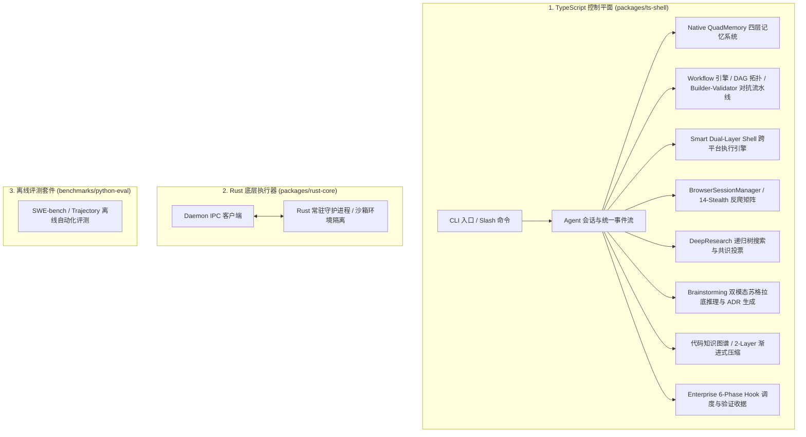
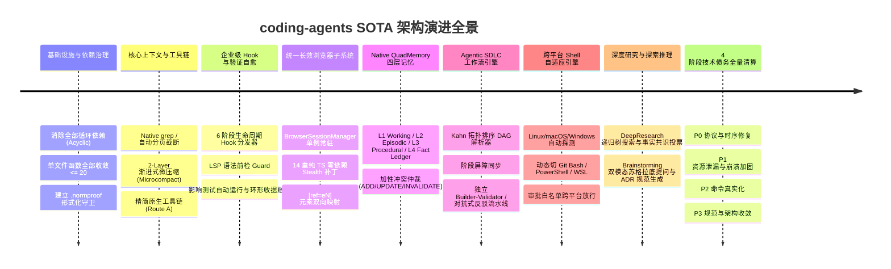

# Coding Agents 项目全景指南 (Project Overview & Architecture Guide)

> **版本**：v0.2.0 (SOTA 架构全面升级与 4 阶段技术债务全量清算交付)  
> **当前 Git 分支**：`normproof-observation`  
> **更新时间**：2026-08-30  

---

## 目录
1. [项目定位与核心架构](#一-项目定位与核心架构)
2. [SOTA 演进里程碑与核心能力全景](#二-sota-演进里程碑与核心能力全景)
3. [核心功能与使用方法 (Build, Test, Verify & Run)](#三-核心功能与使用方法)
4. [核心代码目录与模块导航](#四-核心代码目录与模块导航)
5. [技术债务审计与 4 阶段重构治理报告](#五-技术债务审计与-4-阶段重构治理报告)
6. [技术 RFC 提案与参考知识库](#六-技术-rfc-提案与参考知识库)

---

## 一、 项目定位与核心架构

`coding-agents` 是一个企业级多层自主编码智能体（Autonomous Coding Agent）开发框架，旨在为开发者提供具备**代码知识图谱、原生四层记忆（QuadMemory）、智能体软件工程工作流（Agentic SDLC）、跨平台终端自适应、统一反检测浏览器、细粒度权限控制与 LSP 编译自愈**能力的新一代终端编码助手。

### 三层运行时模型 (Three-Layer Runtime)



---

## 二、 SOTA 演进里程碑与核心能力全景

项目深度解构并吸纳了开源标杆（**Pi, OpenCode, Claude Code, DeepSeek-Harness, Oh-My-Pi, Stagehand, Playwright-MCP, MemPalace, Mem0**）的设计哲学，完成了一系列突破性演进：



### 核心子系统与技术亮点：
1. **Native QuadMemory 四层原生记忆架构 (`core/memory/`)**：
   - **四层存储模型**：L1 活跃工作记忆、L2 项目规则与会话上下文、L3 技能与操作规程、L4 语义事实账本。
   - **加性冲突仲裁器 (`FactArbiter`)**：基于 Jaccard 相似度门禁与矛盾模式匹配，提供 `ADD`、`UPDATE`、`INVALIDATE`、`NOOP` 精确决策，杜绝事实误失效。
   - **混合检索 (`MemoryStore`)**：BM25 词法倒排与实体加权召回。
2. **现代软件工程工作流子系统 (`core/workflow/`)**：
   - **DAG 依赖编排 (`DAGResolver`)**：基于 Kahn 算法实现多任务拓扑排序与环形依赖探测。
   - **解耦构建与验证流水线 (`BuilderValidatorPipeline`)**：独立的 Builder Agent 编写代码，Validator Agent 独立验证，消除自评偏见。
   - **对抗式反驳流水线 (`AdversarialRefuterPipeline`)**：以恶意推翻假设为目标，杜绝假阳性。
3. **跨操作系统自适应 Shell 执行引擎 (`core/shell/platform/`)**：
   - **自适应探测 (`ShellDetector`)**：智能感知 OS (Linux/macOS/Windows)，在 Windows 下自动优先探测 Git Bash、PowerShell 7、Windows PowerShell 与 WSL。
   - **动态切换与执行 (`ShellManager`)**：无缝执行跨平台脚本，在 `/shell status|use|auto` 下提供即时诊断与手动覆盖。
4. **长效反检测浏览器子系统 (`core/tools/browserUnified.ts`, `core/context/browserSessionManager.ts`)**：
   - **常驻 Session 管理**：单例长效维持 Browser Context，跨 Turn 保留页面状态、Cookie 与表单。
   - **14 重 TS 零依赖 Stealth 防护 (`stealthPreload.ts`)**：抹除 `navigator.webdriver`、模拟真实 WebGL / Audio 硬件指纹、修复 Chrome Runtime，轻松绕过主流 WAF 反爬。
   - **高效元素操作**：快照自动生成 `[ref=eN]` 语义引用，支持原生精准点击与输入。
5. **深度研究与共识投票引擎 (`core/research/`)**：
   - **递归树搜索 (`DeepResearcher`)**：自动化多轮查询展开、多源交叉验证。
   - **事实共识投票 (`ClaimVoter`)**：跨信源交叉校验事实可信度，输出结构化 Markdown 研究报告。
6. **双模态创新探索与头脑风暴引擎 (`core/creative/`)**：
   - **苏格拉底模式 (`/brainstorm -i`)**：渐进式追问明确真实边界与约束。
   - **ADR 规范生成模式 (`/brainstorm -s`)**：自动生成标准架构决策记录并持久化至 QuadMemory。

---

## 三、 核心功能与使用方法

### 1. 构建与编译 CLI
```bash
npm run build:ts
```
编译产物自动生成于 `dist/cli.js`。

### 2. 运行自动化测试套件
```bash
npm test
```
全量执行 24 个测试套件，验证 198 项单测，保证 100% 绿色通过。

### 3. 执行 NormProof 形式化架构判定
```bash
npx --package .normproof/normproof-0.1.0.tgz normproof judge
```
验证全仓单向无环依赖（Acyclic）与单文件函数数约束（$\le 20$）。

### 4. 启动终端编码助手
```bash
node dist/cli.js
```

---

## 四、 核心代码目录与模块导航

```text
packages/ts-shell/src/
├── core/
│   ├── commands/                 # Slash 现代化命令运行时
│   │   ├── pluginsAndMarketplace.ts # /marketplace, /plugin 扩展管理
│   │   ├── memoryCommandRuntime.ts  # /memory 原生记忆审查与查询
│   │   ├── workflowCommandRuntime.ts# /workflow SDLC 流水线驱动
│   │   ├── researchCommandRuntime.ts# /deep-research 深度研究引擎
│   │   ├── brainstormCommandRuntime.ts # /brainstorm 创新与 ADR 生成
│   │   ├── shellCommandRuntime.ts   # /shell 跨平台状态与切换
│   │   ├── copyCommandRuntime.ts    # /copy OSC 52 极速剪贴板
│   │   └── btwCommandRuntime.ts     # /btw 旁路问答 (15s 超时)
│   ├── memory/                   # Native QuadMemory 四层原生记忆架构
│   │   ├── types.ts              # 记忆领域契约与实体定义
│   │   ├── memoryStore.ts        # BM25 + 实体倒排混合检索存储
│   │   ├── factArbiter.ts        # 加性冲突仲裁器 (ADD/UPDATE/INVALIDATE)
│   │   └── memoryTools.ts        # retain, recall, reflect, memory_edit 工具
│   ├── workflow/                 # Agentic SDLC 工作流调度与流水线
│   │   ├── types.ts              # DAG 节点与流水线接口
│   │   ├── dagResolver.ts        # Kahn 拓扑排序与环形依赖探测
│   │   ├── pipelineExecutor.ts   # 阶段屏障同步与流水线执行器
│   │   ├── builderValidatorPipeline.ts # Builder-Validator 独立校验流水线
│   │   └── adversarialRefuterPipeline.ts # 对抗式反驳流水线
│   ├── shell/                    # 跨平台自适应 Shell 执行引擎
│   │   ├── platform/
│   │   │   ├── shellDetector.ts  # 智能跨平台环境感知器
│   │   │   └── shellManager.ts   # 多后端 (Git Bash/PowerShell/WSL) 切换调度
│   │   └── approval/
│   │       └── evaluator.ts      # 只读静态命令白名单 (支持跨平台命令)
│   ├── context/                  # 上下文治理与长效会话
│   │   ├── browserSessionManager.ts # 单例常驻浏览器 Context 管理器
│   │   ├── stealthPreload.ts     # 14 重纯 TS 反反爬 Stealth 脚本矩阵
│   │   ├── microCompact.ts       # 2-Layer 渐进式上下文微压缩
│   │   └── contextAnalysis.ts    # 上下文 Token 与注意力热度分析
│   ├── hooks/                    # 企业级生命周期 Hook 调度体系
│   │   ├── hookDispatcher.ts     # 6 阶段异步 Hook 调度中心
│   │   └── builtin/              # 内置守卫 (LSPGuard, TestRunner, ReceiptCollector)
│   ├── research/                 # 深度研究与事实投票子系统
│   │   ├── deepResearcher.ts     # 递归树搜索与多源搜集
│   │   └── claimVoter.ts         # 交叉共识计票与置信度裁决
│   ├── creative/                 # 创新推理与 ADR 生成子系统
│   │   ├── hypothesisGenerator.ts # 假设与头脑风暴生成器
│   │   └── redTeamChallenger.ts   # 红队质疑与对抗挑战器
│   └── tools/                    # 精简且功能完备的原生工具库
│       ├── grep.ts               # 原生高效 Grep 工具
│       ├── browserUnified.ts     # 统一长效 [ref=eN] 浏览器工具
│       ├── webSearch.ts          # 带超时回退的高效网络检索
│       └── webFetch.ts           # 自动清理监听器的轻量网页抓取
```

---

## 五、 技术债务审计与 4 阶段重构治理报告

项目于 2026-08-30 完成了全仓系统性技术审计，形成了详尽的问题清单 [`problem.md`](problem.md)，并分 **4 阶段** 实现了 **全部 20 项缺陷与技术债务的 100% 解决**：

- **Stage 1 (P0 阻塞修复)**：修复多工具验证反馈消息时序、DSML 工具调用协议声明与记忆仲裁否定词误杀。
- **Stage 2 (P1 高危加固)**：贯通 ShellManager Windows 执行、修复跨平台临时目录、建立 500 条上限的 Ring Buffer 环形账本、修复 Browser 页面崩溃自愈、钩子全面异步化并增加 MCP 超时与 EPIPE 守卫。
- **Stage 3 (P2 债务清算)**：`/fast`, `/undo`, `/loop` 联动运行态、`/copy` 升级 OSC 52、`/btw` 动态复用运行时配置、白名单扩充 Windows 命令、Web 工具增加超时并回收监听器。
- **Stage 4 (P3 规范收敛)**：全仓 JSDoc 规范补齐，验证单模块函数数 $\le 20$ 且单向无环。

---

## 六、 技术 RFC 提案与参考知识库

- **系统技术论证与论文库**：`.wiki/wiki/theses/`
  - [`agent-memory-architecture-and-synthesis.md`](.wiki/wiki/theses/agent-memory-architecture-and-synthesis.md) - 原生四层记忆体系论证
  - [`agentic-workflow-and-sdlc-orchestration.md`](.wiki/wiki/theses/agentic-workflow-and-sdlc-orchestration.md) - 工作流与软件工程流水线论证
  - [`cross-platform-shell-execution-and-adaptation.md`](.wiki/wiki/theses/cross-platform-shell-execution-and-adaptation.md) - 跨平台 Shell 执行架构论证
  - [`browser-anti-detection-and-waf-evasion.md`](.wiki/wiki/theses/browser-anti-detection-and-waf-evasion.md) - 浏览器反检测与 WAF 绕过论证
  - [`deep-research-command-architecture.md`](.wiki/wiki/theses/deep-research-command-architecture.md) - 深度研究与共识计票论证
  - [`unlocking-agent-creativity-and-exploratory-reasoning.md`](.wiki/wiki/theses/unlocking-agent-creativity-and-exploratory-reasoning.md) - 创新探索与头脑风暴论证
- **技术 RFC 提案库**：`.wiki/raw/notes/` (RFC-001 ~ RFC-004)
- **技术债务与修复全景清单**：[`problem.md`](problem.md)
