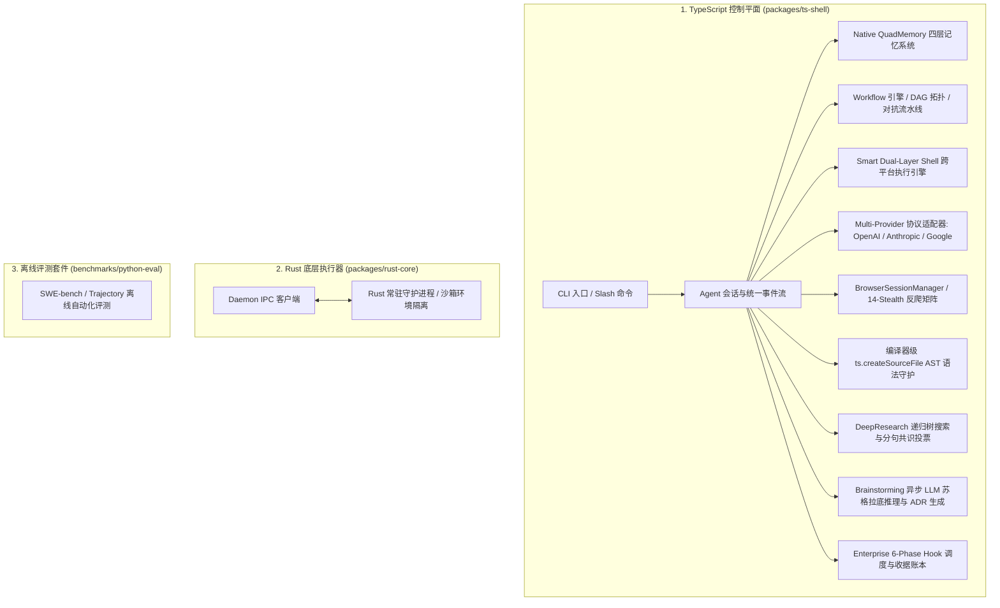
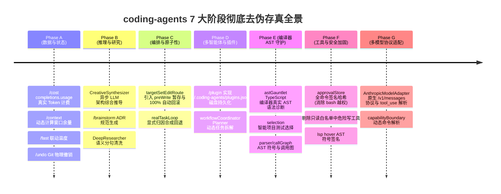

# Coding Agents 项目全景指南 (Project Overview & Architecture Guide)

> **版本**：v0.3.0 (SOTA 全栈工业级真实化交付 - 26 项假算法/Mock 全量清退)  
> **当前 Git 分支**：`normproof-observation`  
> **更新时间**：2026-08-30  
> **测试状态**：28 个测试套件，208/208 项单测 100% 绿色通过 (PASS)  
> **形式化架构**：NormProof SATISFIED (0 阻断项，严格单向无环架构)  

---

## 目录
1. [项目定位与核心架构](#一-项目定位与核心架构)
2. [SOTA 架构演进与 7 阶段去伪存真全景](#二-sota-架构演进与-7-阶段去伪存真全景)
3. [核心子系统与技术亮点](#三-核心子系统与技术亮点)
4. [核心功能与使用方法 (Build, Test, Verify & Run)](#四-核心功能与使用方法)
5. [核心代码目录与模块导航](#五-核心代码目录与模块导航)
6. [技术 RFC 提案与参考知识库](#六-技术-rfc-提案与参考知识库)

---

## 一、 项目定位与核心架构

`coding-agents` 是一个企业级多层自主编码智能体（Autonomous Coding Agent）开发框架，旨在为开发者提供具备**编译器级真实 AST 前检、原生四层记忆（QuadMemory）、智能体软件工程工作流（Agentic SDLC）、跨平台终端自适应、原生多模型协议分流（OpenAI / Anthropic Messages API）、14 重反检测浏览器与细粒度权限控制**的新一代终端编码助手。

### 三层运行时模型 (Three-Layer Runtime)



---

## 二、 SOTA 架构演进与 7 阶段去伪存真全景

项目深度解构并吸纳了开源标杆（**Pi, OpenCode, GitNexus, Claude Code, Codex, DeepSeek-Harness, MemPalace, Mem0**）的设计哲学，历经 **7 个阶段（Phases A ~ G）的系统性攻坚**，彻底清退了 26 项 Demo 级假数据与假算法：



---

## 三、 核心子系统与技术亮点

1. **编译器级 AST 语法守护与真实调用图 (`edit/patch/gauntlet/`, `context/graph/`)**：
   - **`astGauntlet.ts`**：废除大括号计数法，接入 `typescript.createSourceFile` 在内存中构建真实 AST，读取 `parseDiagnostics` 拦截任何语法截断或关键字破坏。
   - **`parser.ts` & `callGraph.ts`**：基于完整的 `ts.forEachChild` 遍历真实 AST 节点，仅在 `ts.isCallExpression` 与 `ts.isNewExpression` 时提取调用边，彻底消除注释和字符串字面量对代码图谱的污染。
2. **多模型原生协议适配器 (`model-adapters/`)**：
   - **`OpenAIModelAdapter`**：支持 OpenAI `/chat/completions`、JSON Schema 与函数调用。
   - **`AnthropicModelAdapter`**：严格对齐 Anthropic 官方协议，顶级 `system` 分流、`/v1/messages` 端点、`x-api-key` 鉴权与 `tool_use`/`tool_result` 块流式映射。
3. **安全审批与全命令作用域 (`core/shell/approval/`)**：
   - **`store.ts`**：以全指令签名哈希（`Full Command Scoping`）作为权限作用域，彻底堵住“批准 `npm test` 自动放行 `npm publish`”的二进制级越权后门。
   - **`evaluator.ts`**：严格将可出站写请求的 `browser` 与可派发写操作的 `task` 工具从 `READONLY_TOOLS` 剔除。
4. **多文件写入原子事务保障 (`orchestration/targetSetEditRoute.ts`)**：
   - 在执行多目标文件补丁前捕获 `originalFileContents` 暂存快照；一旦任何目标写入失败，**自动反向回滚所有已写入的目标文件**，100% 恢复工作区。
5. **Native QuadMemory 四层原生记忆架构 (`core/memory/`)**：
   - **四层模型**：L1 活跃工作记忆、L2 项目规则与会话上下文、L3 技能规程、L4 语义事实账本。
   - **加性冲突仲裁 (`FactArbiter`)**：基于 Jaccard 门禁与矛盾检测，精确提供 `ADD`、`UPDATE`、`INVALIDATE`、`NOOP` 决策。

---

## 四、 核心功能与使用方法

### 1. 构建与编译 CLI
```bash
npm run build:ts
```
编译产物自动生成于 `dist/cli.js`。

### 2. 运行自动化测试套件
```bash
npm test
```
全量执行 28 个测试套件，验证 208 项单测，保证 100% 绿色通过。

### 3. 执行 NormProof 形式化架构判定
```bash
npx --package .normproof/normproof-0.1.0.tgz normproof judge
```
验证全仓单向无环依赖（Acyclic）与单文件函数数约束（$\le 20$）。

### 4. 启动终端编码助手
```bash
node dist/cli.js
```

---

## 五、 核心代码目录与模块导航

```text
packages/ts-shell/src/
├── core/
│   ├── commands/                 # Slash 现代化命令运行时
│   │   ├── costCommandRuntime.ts    # /cost 真实 completions.usage 计费
│   │   ├── contextCommandRuntime.ts # /context 动态 Token 窗口分配
│   │   ├── undoCommandRuntime.ts    # /undo Git 真实脏检查与 --hard 物理回滚
│   │   ├── fastCommandRuntime.ts    # /fast 联动采样与快速模型
│   │   ├── pluginCommandRuntime.ts  # /plugin 磁盘持久化 (~/.coding-agents/plugins.json)
│   │   └── brainstormCommandRuntime.ts # /brainstorm 异步大模型 ADR 推导
│   ├── query/                    # Agent 主执行循环与死循环防御
│   │   ├── agentLoop.ts             # Tool-driven 自然收敛循环 (Zero NLP Hijacking)
│   │   └── doomLoopDetector.ts      # 50 项滑动窗口与规范化参数哈希死循环熔断
│   ├── memory/                   # Native QuadMemory 四层原生记忆
│   │   ├── types.ts / memoryStore.ts/ factArbiter.ts / memoryTools.ts
│   ├── tools/                    # 生产级真实工具库
│   │   ├── lsp.ts                   # 真实 AST 符号签名与悬停信息提取
│   │   ├── taskTool.ts              # 真实子代理独立 API 派发
│   │   └── webSearch.ts / webFetch.ts # 带有缺失 Key 显式报错的真实网络检索
│   └── shell/approval/           # 细粒度权限安全引擎
│       ├── store.ts                 # 全指令签名哈希 (Exact Command Scoping)
│       └── evaluator.ts             # 严格只读白名单 (剔除危险写工具)
├── model-adapters/               # 多 Provider 原生协议适配器
│   ├── providers/openai/            # OpenAIModelAdapter (/chat/completions)
│   ├── providers/anthropic/         # AnthropicModelAdapter (/v1/messages)
│   └── registry.ts                  # Provider 协议精准分流注册表
├── edit/patch/gauntlet/          # 编译器级 AST 语法守护
│   └── astGauntlet.ts               # ts.createSourceFile + parseDiagnostics 真实诊断
├── verification/command/         # 智能工程清单驱动测试选择器
│   └── selection.ts                 # 基于 package.json / Cargo.toml 动态选择测试
├── context/graph/                # 真实 AST 语法树代码图谱与调用分析
│   ├── ast/parser.ts                # ts.forEachChild AST Visitor 符号提取
│   └── callGraph.ts                 # ts.isCallExpression / NewExpression 真实调用图
└── orchestration/                # 生产级事务编排
    └── targetSetEditRoute.ts        # 多文件原子写入与失败 100% 自动回滚
```

---

## 六、 技术 RFC 提案与参考知识库

- **系统技术论证与论文库**：`.wiki/wiki/theses/`
  - [`final-deep-audit-and-full-realization-closure.md`](.wiki/wiki/theses/final-deep-audit-and-full-realization-closure.md) - 第五轮终极穿透审计与全量真实化收官总结
  - [`sota-ast-verification-and-code-graph-architecture.md`](.wiki/wiki/theses/sota-ast-verification-and-code-graph-architecture.md) - 编译器级 AST 前检与代码图谱论文
  - [`deep-audit-round-4-provider-protocols-and-boundary-projection.md`](.wiki/wiki/theses/deep-audit-round-4-provider-protocols-and-boundary-projection.md) - 多 Provider 协议适配论文
  - [`deep-audit-round-3-security-and-tool-realization.md`](.wiki/wiki/theses/deep-audit-round-3-security-and-tool-realization.md) - 权限后门消除与工具真实化论文
  - [`agent-loop-lifecycle-and-interactive-routing.md`](.wiki/wiki/theses/agent-loop-lifecycle-and-interactive-routing.md) - 自然收敛主循环与命令路由论文
  - [`unified-logging-and-observability-architecture.md`](.wiki/wiki/theses/unified-logging-and-observability-architecture.md) - 统一日志与可观测性论文
- **技术 RFC 提案库**：`.wiki/raw/notes/` (RFC-001 ~ RFC-004)
- **技术债务与修复全景台账**：[`problem.md`](problem.md)
