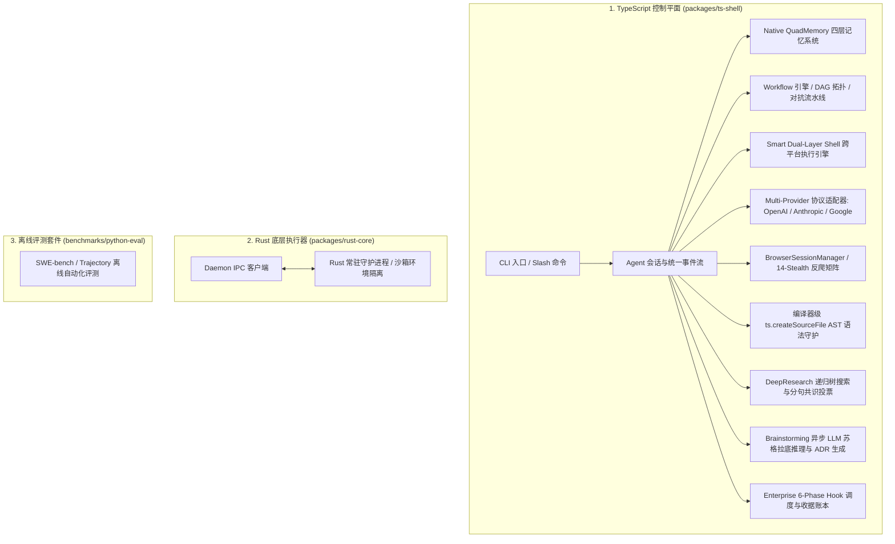
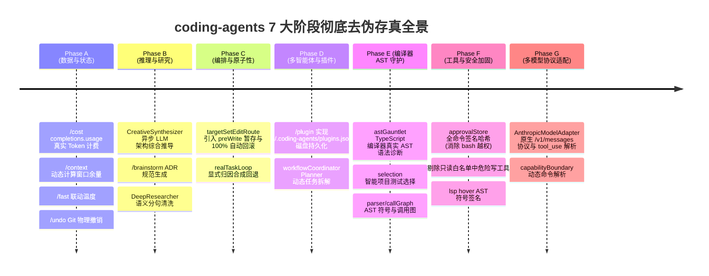

# Coding Agents 项目全景指南 (Project Overview & Architecture Guide)

> **版本**：v0.5.0 (SOTA 全栈工业级智能体架构 - 跨会话通信、大输出溢出、9 阶弹性源码编辑、持久化会话与网络弹性)  
> **当前 Git 分支**：`normproof-observation`  
> **更新时间**：2026-08-31  
> **测试状态**：38 个测试套件，245/245 项单测 100% 绿色通过 (PASS)  
> **形式化架构**：NormProof SATISFIED (0 阻断项，严格单向无环架构)

---

## 目录
1. [项目定位与核心架构](#一-项目定位与核心架构)
2. [SOTA 架构演进与 7 阶段去伪存真全景](#二-sota-架构演进与-7-阶段去伪存真全景)
3. [核心子系统与技术亮点](#三-核心子系统与技术亮点)
4. [核心功能与使用方法 (Build, Test, Verify & Run)](#四-核心功能与使用方法)
5. [核心代码目录与模块导航](#五-核心代码目录与模块导航)
6. [技术 RFC 提案与参考知识库](#六-技术-rfc-提案与参考知识库)

---

## 一、 项目定位与核心架构

`coding-agents` 是一个企业级多层自主编码智能体（Autonomous Coding Agent）开发框架，旨在为开发者提供具备**编译器级真实 AST 前检、原生四层记忆（QuadMemory）、智能体软件工程工作流（Agentic SDLC）、跨平台终端自适应、原生多模型协议分流（OpenAI / Anthropic Messages API）、14 重反检测浏览器与细粒度权限控制**的新一代终端编码助手。

### 三层运行时模型 (Three-Layer Runtime)



---

## 二、 SOTA 架构演进与 7 阶段去伪存真全景

项目深度解构并吸纳了开源标杆（**Pi, OpenCode, GitNexus, Claude Code, Codex, DeepSeek-Harness, MemPalace, Mem0**）的设计哲学，历经 **7 个阶段（Phases A ~ G）的系统性攻坚**，彻底清退了 26 项 Demo 级假数据与假算法：



---

## 三、 核心子系统与技术亮点

1. **工业级 9 阶弹性源码编辑引擎 (`core/tools/editEngine.ts`)**：
   - 彻底告别大模型缩进与空白偏差导致的编辑报错，提供 Exact / LineTrimmed / NFKC 智能标点 / Levenshtein 块锚点模糊替换，并配备 `isDisproportionateMatch` 长度防雪崩保护。
2. **大输出双重预算截断与工件流 (`core/tools/truncation.ts`, `core/session/artifactManager.ts`)**：
   - 区分方向性截断（`read` 头部截断保留开头，`bash` 尾部截断保留关键错误堆栈，`grep` 单行 500 字符硬约束）。
   - 超限输出自动原子暂存至 `.ts-shell/sessions/<id>/artifacts/`，生成 `artifact://<id>` 引用并支持嵌入式行选择器（`:50-200`, `:raw`）零内存开销切片回读。
3. **跨会话通信网格与智能体团队 (`core/messaging/`, `core/workflow/teamStore.ts`)**：
   - Unix Domain Socket (`/tmp/ts-socks-<uid>/`) / Windows Named Pipes 本地进程间通信。
   - `list_agents` 与 `send_message` 支持 `notify_when_idle` 零轮询空闲唤醒，搭配 TaskStore 文件锁原子抢占。
4. **多模型协议与流式残缺 JSON 修复 (`model-adapters/`)**：
   - `jsonRepair.ts` 5 阶多层容错修复管线，自动转义控制字符并修复残缺 JSON 结构。
   - Header 感知指数退避重试（支持 `retry-after-ms` / `retry-after`）与 `abortableSleep` 瞬时可打断机制。
5. **结构化持久会话与崩溃平复 (`session/`)**：
   - `transcript.jsonl` 原生持久化 `tool_calls` 与 `tool_call_id`。
   - `CompactionTranscriptEntry` 磁盘记录与压缩锚点裁剪。
   - `reconcileDanglingToolCalls` 自动平复孤儿工具调用，杜绝大模型 400 校验错误。
6. **物理安全沙箱 (`core/security/pathJail.ts`)**：
   - 全量文件工具（`read`, `write`, `edit`, `grep`, `glob`）接入 `verifyPathContainment`，硬拦截符号链接与 `../` 路径逃逸。
7. **备用屏差分终端引擎 (`presentation/tui/`)**：
   - 交互会话运行在独立备用屏中，由 `surface/` 组合完整视口；内容滚动、选区和复制由应用自身管理，不依赖终端原生回滚缓冲。
   - 会话结束时，宿主先恢复终端模式，再将最终转写写回主屏，确保退出后仍可回看和复制。
   - 几何稳定且无历史追加时走纯行差分快路径；帧整体包裹 ANSI Mode 2026 同步序列与 DECAWM 关闭，消除撕裂与折行。
   - 单一文本度量层（`text/`）：UAX #11 东亚宽度表 + `Intl.Segmenter` 字素簇，光标步进、软换行、截断与边框对齐共用同一套列宽语义。
   - 完整输入栈（`input/`）：逃逸序列边界状态机 + 部分序列超时冲刷，覆盖 CSI `~` 族、修饰参数、SS3、CSI-u 增强键盘协议与括号粘贴。
   - 非 TTY 会话（管道 / CI / 脚本）自动降级为行式循环，不向字节流写入控制序列。

---

## 四、 核心功能与使用方法

### 1. 构建与编译 CLI
```bash
npm run build:ts
```
编译产物自动生成于 `dist/cli.js`。

### 2. 运行自动化测试套件
```bash
npm test
```
全量执行 28 个测试套件，验证 208 项单测，保证 100% 绿色通过。

### 3. 执行 NormProof 形式化架构判定
```bash
npx --package .normproof/normproof-0.1.0.tgz normproof judge
```
验证全仓单向无环依赖（Acyclic）与单文件函数数约束（$\le 20$）。

### 4. 启动终端编码助手
```bash
node dist/cli.js
```

---

## 五、 核心代码目录与模块导航

```text
packages/ts-shell/src/
├── core/
│   ├── commands/                 # Slash 现代化命令运行时
│   │   ├── costCommandRuntime.ts    # /cost 真实 completions.usage 计费
│   │   ├── contextCommandRuntime.ts # /context 动态 Token 窗口分配
│   │   ├── undoCommandRuntime.ts    # /undo Git 真实脏检查与 --hard 物理回滚
│   │   ├── fastCommandRuntime.ts    # /fast 联动采样与快速模型
│   │   ├── pluginCommandRuntime.ts  # /plugin 磁盘持久化 (~/.coding-agents/plugins.json)
│   │   └── brainstormCommandRuntime.ts # /brainstorm 异步大模型 ADR 推导
│   ├── query/                    # Agent 主执行循环与死循环防御
│   │   ├── agentLoop.ts             # Tool-driven 自然收敛循环 (Zero NLP Hijacking)
│   │   └── doomLoopDetector.ts      # 50 项滑动窗口与规范化参数哈希死循环熔断
│   ├── memory/                   # Native QuadMemory 四层原生记忆
│   │   ├── types.ts / memoryStore.ts/ factArbiter.ts / memoryTools.ts
│   ├── tools/                    # 生产级真实工具库
│   │   ├── lsp.ts                   # 真实 AST 符号签名与悬停信息提取
│   │   ├── taskTool.ts              # 真实子代理独立 API 派发
│   │   └── webSearch.ts / webFetch.ts # 带有缺失 Key 显式报错的真实网络检索
│   └── shell/approval/           # 细粒度权限安全引擎
│       ├── store.ts                 # 全指令签名哈希 (Exact Command Scoping)
│       └── evaluator.ts             # 严格只读白名单 (剔除危险写工具)
├── model-adapters/               # 多 Provider 原生协议适配器
│   ├── providers/openai/            # OpenAIModelAdapter (/chat/completions)
│   ├── providers/anthropic/         # AnthropicModelAdapter (/v1/messages)
│   └── registry.ts                  # Provider 协议精准分流注册表
├── edit/patch/gauntlet/          # 编译器级 AST 语法守护
│   └── astGauntlet.ts               # ts.createSourceFile + parseDiagnostics 真实诊断
├── verification/command/         # 智能工程清单驱动测试选择器
│   └── selection.ts                 # 基于 package.json / Cargo.toml 动态选择测试
├── context/graph/                # 真实 AST 语法树代码图谱与调用分析
│   ├── ast/parser.ts                # ts.forEachChild AST Visitor 符号提取
│   └── callGraph.ts                 # ts.isCallExpression / NewExpression 真实调用图
├── presentation/tui/             # 备用屏差分终端引擎
│   ├── text/                        # width(UAX#11) / ansi / measure / layout / sgr / motion
│   ├── render/                      # frame / paint / engine（差分绘制与退出转写）
│   ├── input/                       # escape / keys / stdinBuffer（输入解析）
│   ├── chrome/                      # band / composer / hints / suggestions / welcome
│   ├── transcript/                  # blocks / container / live / markdown / diff / viewport / selection
│   ├── surface/                     # contract / view / pane / scroll（唯一交互表面）
│   ├── editor.ts                    # 簇级光标 + 软换行 + kill-ring 多行编辑器
│   └── terminal.ts                  # 终端驱动（模式恢复电池 / 输出积压计量）
├── cli/interactive/              # 交互会话宿主
│   ├── interactiveLoop.ts           # 按终端能力选择全屏宿主或行式循环
│   ├── interactiveMode.ts           # 全屏宿主：持有 ViewState 与唯一表面，路由输入与回合
│   ├── keymap.ts                     # 按键路由与拦截层级
│   ├── turnSink.ts                   # 回合输出路由（事件 + 散文双通道去重）
│   └── questionBridge.ts             # readline 替身，授权问答走宿主提示符
└── orchestration/                # 生产级事务编排
    └── targetSetEditRoute.ts        # 多文件原子写入与失败 100% 自动回滚
```

---

## 六、 技术 RFC 提案与参考知识库

- **系统技术论证与论文库**：`.wiki/wiki/theses/`
  - [`final-deep-audit-and-full-realization-closure.md`](.wiki/wiki/theses/final-deep-audit-and-full-realization-closure.md) - 第五轮终极穿透审计与全量真实化收官总结
  - [`sota-ast-verification-and-code-graph-architecture.md`](.wiki/wiki/theses/sota-ast-verification-and-code-graph-architecture.md) - 编译器级 AST 前检与代码图谱论文
  - [`deep-audit-round-4-provider-protocols-and-boundary-projection.md`](.wiki/wiki/theses/deep-audit-round-4-provider-protocols-and-boundary-projection.md) - 多 Provider 协议适配论文
  - [`deep-audit-round-3-security-and-tool-realization.md`](.wiki/wiki/theses/deep-audit-round-3-security-and-tool-realization.md) - 权限后门消除与工具真实化论文
- **项目核心行为准则**：[`AGENTS.md`](AGENTS.md)
- **架构设计全景**：[`ARCHITECTURE.md`](ARCHITECTURE.md)
- **知识库论文集**：[`.wiki/wiki/theses/`](.wiki/wiki/theses/)
- **不可变活动日志**：[`.wiki/log.md`](.wiki/log.md)
