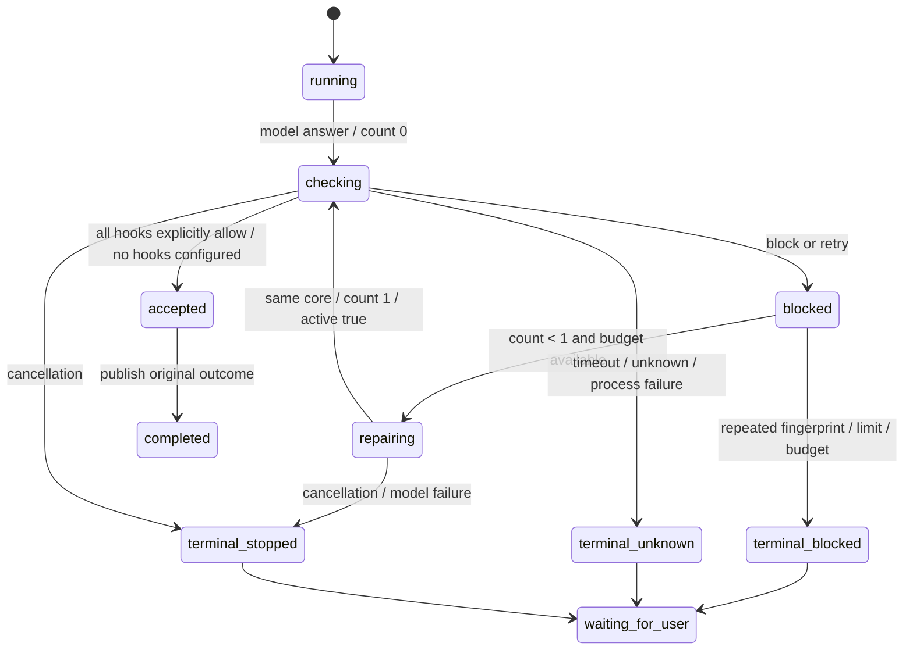

# C2 执行记录：Stop 的有界完成生命周期

基点：`c7219e6aa0fdae09ca2de06c2090f57098add057`（C1），启动工作树干净。
状态：C2 本地实现及全部七条验收完成；未提交、未推送、未验证远端 CI。下列契约在产品代码修改前写入。
仅修改 Cheers。

2026-11-06 的 R0b 实现及验收见 [信封执行记录](stop-envelope-execution.md)。操作者已解除
中性事件协议的停止条件，授权新增 query.completed_unproven 和全部消费方。
already_blocked_once / not_configured + not_reported 现在中性结束，仍不声称 proven；其余
unknown 类继续失败。下文是 C2 原始契约及历史证据，第 5 条中的两类原因由 R0b 明确分流，
原 unknown 无完成断言与 bounded re-entry 守卫仍保留，不能用 C2 历史回执替代 R0b 验收。

## Re-entry 契约原文

1. Stop 是本轮完成检查。候选 model answer 不等于成功完成。首次 `block/retry`
   先写 `checking → blocked`，不得发送候选 `outcome.completed`；有剩余模型步数且未取消时，
   写 `repairing` 并在同一个 AgentCore、同一个用户请求内最多重入一次。
2. 显式常量 `MAX_STOP_REENTRIES = 1`。整个逻辑完成尝试使用同一个随机 `attemptId`；
   `reentryCount` 为 0（首次）或 1（修复），`stop_hook_active` 等于 count > 0。
   每条结构化记录携带这些字段及单调递增 `sequence`。不重置模型步数、权限、取消、
   provider admission 或 overflow-recovery guard；修复指令是内部 system 消息，不伪装用户授权。
3. `progressFingerprint` 是版本化结构，由参与检查的 canonical command identity、
   稳定 `reasonCode`、原样分类的 `proofVerdict` 和排序去重的 `evidenceIdentity` 组成。
   command 只去首尾空白再 SHA-256；不改引号内空白等 shell 语义。进程内 hook 使用稳定 name
   （未命名使用明确的 unnamed identity）。evidence 使用 hook 提供的稳定标识，缺失明确记为
   `unspecified`，proof 缺失记为 `not_reported`，绝不从 model answer/block/exit 0 推导 proven。
   原始 reason、路径展示文本、动态提示和 hook 顺序不参与重复身份。
4. 相同 fingerprint 再次 block：终态 `blocked/repeated_block`。不同 fingerprint 再次 block：
   `blocked/reentry_limit`。模型预算不足：`blocked/step_limit`。均无第三次模型修复或 completed。
5. timeout、unknown、unsupported、格式错误、进程/handler 失败：终态 `unknown`，不修复、
   不成功。显式 allow 才接纳该 hook；空输出/void 与 `could_not_judge/could_not_decide`、
   `already_blocked_once`、`not_configured` 不能证明完成检查，保留 unknown。未配置任何 Stop hook
   时沿用原完成语义，并明确记录 `not_configured`，不声称 proof passed。
6. 取消保留 `stopped/cancelled`，忽略迟到结果。Stop 的内部状态从不 terminate 会话。
   最终 blocked/unknown 使用 `query.failed` 结束本轮并保留结构化终态；后续人工请求仍可执行。
   取消只记录 stopped，保留既有 quiet cancellation，由 shell 保存 interrupted。
   普通 provider 失败沿既有 StopFailure 路径，不触发 Stop 修复。
7. `.agents/hooks.json` 的 `hooks.<event>[].hooks[]` handler 读取可选正安全整数
   `timeoutMs`（毫秒），沿 declaration → registration → dispatcher 保留；默认 Stop 3000 ms。
   无效值报告配置问题并使用默认预算，不丢弃整个安全 hook。group 层 timeoutMs 和秒单位
   timeout 不作为该字段。PreToolUse 决策语义不变。进程内 Stop handler 同样有可取消期限。
8. 查询事件 `type: lifecycle.record` 是持久记录载体，带 `kind` 区分 `model_answer`、
   `hook_result`、`permission`、`execution`、`proof_verdict` 及 `stop_state`。
   由现有 ShellSessionRuntime 调用 `manager.appendQueryEvent` 写入 session transcript；
   保留顺序、attempt、fingerprint 和最终状态。模型/工具正文仍由已有 transcript owner 保存，
   新记录仅保留身份与状态；hook 的 reason 仅作为有界内部修复输入，不作为 proof identity。
   测试通过真实 manager 写入后重新读取并导出样例，不手工构造验收 JSON。

## 状态机可表达性与改动图

现有 `AgentCore.continue` 支持在上一回答后继续，ShellStateMachine 在运行期间保持 running，
终态 error 允许下一次 startRun；不存在必须 terminate 才能拒绝完成的限制。新增的是 turn owner
内的显式 Stop 子状态，无需改变会话身份或重建权限/预算。



## 有针对性的参考比较

- Claude Code `query.ts:1258–1305`：API error 不进入 Stop；block 注入反馈后继续；携带 active flag；
  保留 reactive compact guard。本设计同意这些决定，测试覆盖失败、反馈、active、共享预算。
- 参考 `query/stopHooks.ts` 对异常返回无阻断；本设计明确不同：操作者要求未知不能成功。
- NormProof `completion-gate-contracts.ts` 当前只有 block 输出；allow（含未知与 already_blocked_once）
  静默。无法区分的空输出在本宿主记 unknown；不修改 NormProof，也不宣称旧协议已可证明修复成功。
- NormProof `decision.ts` 的 reason 带路径及渲染顺序；本设计只用结构化标识判重复，缺失字段
  有明确保守身份；动态 reason 改变不得制造新修复预算。

## 持久记录载体选择理由

query event 已由真正会话消费者落盘，具备 session/source-entry 归属、顺序、重放与恢复入口。
复用它可把模型回答、审批、工具执行、hook 结果和 proof verdict 放到同一有序轨迹，避免另建
无消费者日志或把模型文本当作证明。最终示例和命令输出将在测试实际生成后归档。

## 验证与交付

命令在 Cheers 根目录执行（注明 cwd 的除外）。每个重型命令串行运行，Vitest 最多两个 worker。
源码始终由主代理修改和验证，没有委派执行或并行重型验证。

### 验收 1–6：真实测试输出

```bash
rtk proxy bash -c 'VITEST_MAX_THREADS=2 VITEST_MIN_THREADS=2 CHEERS_STOP_EVIDENCE=/home/wang/projects/cheers/.tmp/stop-validation/records.json npm run test:ts -- src/turn/stop.test.ts src/core/hooks/stop/dispatch.test.ts'
```

```text
Test Files  2 passed (2)
     Tests  40 passed (40)
```

完整输出：[acceptance.txt](evidence/stop/acceptance.txt)。测试输出直接解析出的
[probes.json](evidence/stop/probes.json) 保留各探针最终状态；没有手写或补齐 verdict。

| 验收 | 真实观察 |
| --- | --- |
| 1. 首次 block 不发 completed | 在第二次模型调用人为挂起时断言零 completed，且已收到 repairing；释放后才有 1 次最终 completed |
| 2. 一次受控 re-entry | `block-repair-allow`：attempts=2、reentries=1、completed=1；两次 payload 同 attemptId，count/active 分别为 0/false 和 1/true；第二次看到内部 repair 指令 |
| 3. 重复 fingerprint | `same-fingerprint`：attempts=2、reentries=1、completed=0、terminal blocked/repeated_block；reason 动态路径变化及 evidence 重排不改变 fingerprint；不同 evidence 则 blocked/reentry_limit |
| 4. timeout/unknown | `timeout`、`unknown`、`command-timeout`、`command-nonzero`、`command-empty` 均 attempts=1、completed=0、terminal unknown；could_not_decide、could_not_judge、already_blocked_once、unsupported 单独通过 |
| 5. JSON timeout | 同一真实 `sleep 0.35` 命令，handler timeoutMs=80 得 unknown/timeout；timeoutMs=1200 得 allow。具体耗时见下述原始 JSON；隔离 homeDir 与显式 trustStore，approvalCalls=1 |
| 6. 五类持久事实 | 真正 ShellSessionRuntime → manager.appendQueryEvent → 重新 new SessionManager 读回 16 条；五类 kind 及 stop_state 均存在，sequence 连续、attemptId 唯一、最终 blocked；审批 1 次、合成修复工具真实写文件 1 次；同一会话随后接受新请求 |

配置确切形状（测试写入后读回）：

```json
{"hooks":{"Stop":[{"hooks":[{"command":"sleep 0.35; printf '%s' '{\"decision\":\"allow\",\"reasonCode\":\"proven\",\"proofVerdict\":\"proven\"}'","timeoutMs":80}]}]}}
```

实测毫秒数直接保留在 [probes.json](evidence/stop/probes.json) 的两个 `hooks-json-timeout` 记录。
首次聚焦实测 88 ms / 359 ms，后续重验保留各自实测值，不把某次耗时当作性能保证。

持久样例全文：[records-final.json](evidence/stop/records-final.json)。它由测试在真实落盘后读取并
写出；包含 `model_answer`、`hook_result`、`permission` requested/approved、`execution`
reported_success、`proof_verdict` refuted，以及 count=1 的 terminal blocked/repeated_block。
execution 是工具报告，与 proof verdict 是不同事实；合成模型/工具不代表真实 provider/proof engine。

额外集成：`src/core/hooks/translation.integration.test.ts`、`trust.test.ts`、`registration.test.ts`、
`src/core/shell/sessionRuntime.test.ts`、`src/core/query/runtime/events.test.ts` 与两份 Stop 测试合计
7 文件 144 项通过，见 [integration.txt](evidence/stop/integration.txt)。取消、剩余模型预算、
closing 禁工具、provider 失败不修复、移除原阻断 hook、失效晚到批准、实际子进程失败/取消、
结构化事件读取拒绝损坏记录均有断言。后加的大 timer 分段及原 proof verdict 保存使 Stop 聚焦共 40 项。

### 反转验证和 Node floor

六项反转分别移除完成前判断、把重入上限改为 2、将原始 reason 用作 identity、清除 active flag、
丢弃 loader timeoutMs、将 unknown 当作 allow。全部出现 AssertionError，之后逐字节恢复。
摘要：[reversal-summary.json](evidence/stop/reversal-summary.json)；日志分别为
[消费](evidence/stop/reversal-final-completion-consumption.txt)、
[上限](evidence/stop/reversal-final-reentry-cap.txt)、
[指纹](evidence/stop/reversal-final-reason-identity.txt)、
[active](evidence/stop/reversal-final-active-flag.txt)、
[timeout](evidence/stop/reversal-final-timeout-loader.txt)、
[unknown](evidence/stop/reversal-final-unknown-policy.txt)。

实际 runner：cwd=`packages/ts-shell`，`rtk proxy node ../../node_modules/vitest/vitest.mjs run <test> -t <pattern>`。
前两次脚本的 npm `EUNKNOWNCONFIG --t` 与包内 runner `MODULE_NOT_FOUND` 是无效反转，
单独保留 `reversal-*.txt` / `reversal-valid-completion-consumption.txt`，不计入六项断言证据。

恢复后 40 项在 Node v24.15.0 与 Node v20.3.0 分别通过：

```bash
cd packages/ts-shell
rtk env VITEST_MAX_THREADS=2 VITEST_MIN_THREADS=2 ../../.omx/cache/node-floor/node-v20.3.0-linux-x64/bin/node ../../node_modules/vitest/vitest.mjs run src/turn/stop.test.ts src/core/hooks/stop/dispatch.test.ts
```

输出：[restored-node-floor.txt](evidence/stop/restored-node-floor.txt)。

### 静态门、构建、结构和全量链

```bash
rtk npm run verify:import-cycles && rtk npm run check:config-consumers && rtk npm run check:declarations && rtk npm run check:node-floor && rtk npm run verify:docs-drift:strict && rtk npm run test:scripts && rtk npm run build && rtk npm run analyze:module-facades -- --all
rtk proxy node .tmp/stop-validation/judge/package/dist/adapters/cli/normproof.js judge .normproof/judge-input.json .tmp/stop-validation/judge-output --evidence-manifest .normproof/evidence-manifest.json
```

五静态门、191 项 scripts、正式 build `f32e6a807497` 通过。
[final-gates.txt](evidence/stop/final-gates.txt) 含全命令输出；119 个已有 docs-source advisory 保留。
本仓自带 archive 解包 judge 退出 0，[verdict.json](evidence/stop/verdict.json) 为 partial：
循环/未解析导入 satisfied，阻塞 0；已有 interactiveMode.ts/test.ts 两处 20-name 上限失败。
C2 新增/修改模块没有新增上限 finding，不修改原 disposition。

首次裸 tsc 使用了包含全部测试且非 strict 的 tsconfig.json，产生大量全仓错误，属于错误验证入口，
不算正式 typecheck；正式 build 使用 tsconfig.build.json。首次正式 build 发现 execFile 的 detached
选项无类型支持，已改为真实 spawn process group 并通过后续 build；失败输出见
[build.txt](evidence/stop/build.txt)。

首次完整链：5 文件/7 项失败，1092 文件/14310 项通过、2 skipped，1132.67 秒。
七项全部是源码修改后旧 build manifest 拒绝 CLI 启动，见
[full-suite.txt](evidence/stop/full-suite.txt)。此轮不计全量验收通过。

最终链基于新鲜构建运行并退出 0，完整输出：[final-suite.txt](evidence/stop/final-suite.txt)：

```bash
rtk proxy bash -c 'npm run verify:import-cycles && npm run check:declarations && npm run check:node-floor && VITEST_MAX_THREADS=2 VITEST_MIN_THREADS=2 npm run test:ts'
```

```text
scc-gate runtime_cycles=0 type_only_cycles=0
declaration-check hook_events=18 dispatched=18 tool_factories=13 registered=13 findings=0
[pass] node-floor - no use of a runtime API newer than the declared >=20.3.0
Test Files  1097 passed (1097)
     Tests  14321 passed | 2 skipped (14323)
  Duration  1160.22s
```

两项既有 skipped 保留；七项旧构建拒绝均在此轮通过。全量运行期间源码冻结。
cap 测试在最终全量前已改为优先检查真实 attempt 次数；收尾再次反转观察到 3 次而非允许的 2 次，
恢复后 40 项聚焦与 docs-drift/diff 再通过，见 [final-check.txt](evidence/stop/final-check.txt)。
最终源码仍与全量验收版本逐字节一致；`rtk proxy node dist/cli.js --version` 实测输出 `0.1.0`，
确认构建新鲜度检查接受当前输入。

### 边界

已验证 Linux 上真实 hook 子进程、真实 session 文件、合成模型/修复工具与普通 permission。
未调用真实 provider、未运行 macOS/Windows、未推送或验证远端 CI。
handler 超时只能舍弃晚到进程内结果，不能强制中止任意宿主 JS 副作用；command 用进程组结束。
hook 自报 verdict 保留来源事实，不等价于独立证据审计；旧 NormProof 静默 completion 协议仍 unknown。

Commit message 版本：

```text
feat(hooks): enforce Stop decisions with one bounded repair attempt

Consume completion checks before publishing terminal success. Preserve attempt,
proof and execution facts in the durable query event stream; keep undecidable
checks and exhausted repair attempts stopped. Retain handler timeoutMs through
declaration loading and registration without changing PreToolUse decisions.
```
