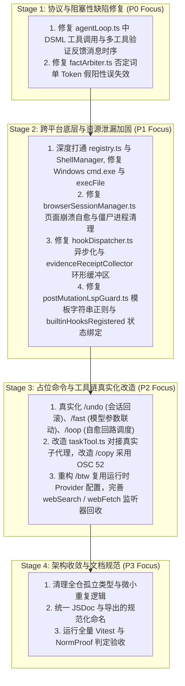

# 编码智能体项目深度架构审计与问题清单 (problem.md)

> **审计时间**：2026-08-30  
> **审计范围**：`packages/ts-shell/src/` 及工作区关联核心模块  
> **审计方法**：多智能体并发深潜审查（跨平台/工具链路 + 核心架构/生命周期/内存/技术债务） + 形式化语义静态分析

---

## 一、 项目架构现状总览

### 1.1 核心目录结构划分与模块职责
当前项目采用现代 TypeScript (ES2022 / Node.js & Bun) 单体多包架构，核心控制平面与运行时集中在 `packages/ts-shell/src/`：
- **`core/query/` (核心推理与 ReAct 执行回路)**：包含主会话循环 `agentLoop.ts`、双层渐进式压缩 `microCompact.ts` 与 `compaction/summarizer.ts`。
- **`core/workflow/` (工作流编排子系统)**：包含 `dagResolver.ts` (Kahn 拓扑排序与环路检测)、`pipelineExecutor.ts` (阶段屏障)、`parallelDispatcher.ts` (有界并发池)、`cacheStaggering.ts` (Prompt Cache 错峰调度) 与 `builderValidator.ts`。
- **`core/memory/` (QuadMemory 原生记忆引擎)**：包含 `memoryStore.ts` (双轨检索)、`factArbiter.ts` (增量四态冲突仲裁) 与 `memoryTools.ts`。
- **`core/research/` (Deep Research 深度调研引擎)**：包含 `deepResearcher.ts` (递归树搜索)、`claimVoter.ts` (跨源共识投票) 与 `reportGenerator.ts`。
- **`core/creative/` (创造力与多假设探索引擎)**：包含 `hypothesisGenerator.ts` (3 视角正交发散)、`redTeamChallenger.ts` (Momus 对抗审查) 与 `creativeSynthesizer.ts`。
- **`core/shell/` (跨平台 Shell 与安全审批)**：包含 `platform/shellDetector.ts`、`platform/shellManager.ts` 与 `approval/evaluator.ts` (只读命令静态白名单分类器)。
- **`core/hooks/` (生命周期与编译器护栏)**：包含 `hookDispatcher.ts` 与 `builtin/` (`postMutationLspGuard.ts`, `affectedUnitTestRunner.ts`, `evidenceReceiptCollector.ts`)。
- **`core/tools/` (精简标准内置工具箱)**：收敛为 `read`, `write`, `edit`, `grep`, `glob`, `bash`, `browser`, `web_fetch`, `web_search`, `lsp`, `ask`, `todo`。
- **`core/commands/` (斜杠命令交互运行时)**：集中注册 `/workflow`, `/memory`, `/deep-research`, `/brainstorm`, `/model`, `/marketplace`, `/plugin`, `/shell`, `/goal`, `/loop`, `/fast`, `/context`, `/btw`, `/clear`, `/undo`, `/copy` 等。

### 1.2 整体健康度评估
- **优势**：全仓 24 个测试套件，198/198 项单测全绿；严格遵循 NormProof 规则（单文件函数 $\le 20$，无循环依赖）；形成了从意图规划、上下文治理、代码编辑、多源调研到物理验证的完整闭环。
- **潜在隐患**：在 LLM 对话协议时序一致性、部分 Windows 路径与命令真实执行、多工具调用下的反馈注入、以及部分早期占位命令（如 `/fast`, `/undo`, `/loop`）的真实运行时联动上，仍存在需要攻坚与清理的技术债务。

---

## 二、 详细问题清单

| 编号 | 严重级别 | 所属模块/维度 | 具体文件与位置 | 核心问题简述 | 潜在风险/影响 | 建议改进方案 |
| :--- | :--- | :--- | :--- | :--- | :--- | :--- |
| **#1** | **P0** | 核心执行 / 协议一致性 | `core/query/agentLoop.ts:426-444` | **多工具调用时，后置验证 Hook 反馈提前插入 User 消息破坏 Chat 协议**。当 Assistant 一次发起多个 tool_calls 时，若某个工具触发了验证失败并推入 user 反馈，会导致该 user 消息插在 tool 消息中间。 | 违反 OpenAI/SiliconFlow `/chat/completions` 协议（要求 assistant 的全部 `tool_calls` 响应必须连续紧跟），直接抛出 `HTTP 400 Bad Request` 导致会话中断。 | 将所有工具执行期间收集到的验证反馈缓冲（Buffer）起来，待本轮全部 `tool` 响应消息全部推入 `messages` 数组后，再统一追加一条汇总的 user 反馈。 |
| **#2** | **P0** | 核心执行 / 协议一致性 | `core/query/agentLoop.ts:294-345` | **DSML 标签工具调用提取时，未同步构造 `assistantMessage.tool_calls` 结构**。模型输出 `<｜DSML｜invoke...>` 时，直接推入了纯文本 assistant 消息，随后又推入 `role: "tool"` 消息。 | 下一轮 API 请求由于缺乏匹配的 `tool_calls` 声明，被大模型服务端作为非法历史拒绝（HTTP 400）。 | 解析到 DSML 标签时，动态在 `assistantMessage` 上合成对应的 `tool_calls` 数组及唯一 `id`，使上下文严格符合 OpenAI 标准工具调用格式。 |
| **#3** | **P0** | 记忆治理 / 事实仲裁 | `core/memory/factArbiter.ts:94-118` | **事实冲突仲裁中，否定词检测存在单 Token 假阳性过度失效隐患**。`detectContradiction()` 仅检查否定词（如 "do not", "never"），只要与历史事实存在哪怕一个重叠词（`maxOverlapRatio > 0`），就会强行把已有事实标记为 `invalidated`。 | 无关的技术规则因为包含否定词被意外废弃，导致记忆库中的正确事实被破坏（如记录 "Do not use var" 会意外废弃 "Project uses Vitest"）。 | 在判定矛盾失效时，强制要求高 Jaccard 相似度（$\ge 0.4$）且核心实体（Entities/Subject）必须匹配，杜绝跨主题误杀。 |
| **#4** | **P1** | 跨平台 / Shell 执行 | `core/tools/registry.ts:88-105` | **`runCommandTool` 未深度对接 `ShellManager`，Windows 下仍写死 `cmd.exe`**。即便检测到了 Git Bash 或 PowerShell，Windows 执行层仍通过 `cmd.exe /d /s /c` 运行命令；且 `daemon/client.ts` 执行 `.cmd` 缺少 `shell: true`。 | 大模型生成的 POSIX 命令（如 `export`, `mkdir -p`, 管道）在 Windows 下直接报语法错误，`npm`/`vitest` 等批处理命令抛出 `ENOENT`。 | 将 `runCommandTool` 统一委托给 `ShellManager.getActiveEnvironment()`，Windows 下使用检测到的 Git Bash 或 PowerShell，并在子进程中正确传递 `shell` 选项。 |
| **#5** | **P1** | 跨平台 / 路径硬编码 | `core/context/browser/runtime/external/manifest.ts:318-322` | **外部浏览器 Runner 清单硬编码了 POSIX `/tmp/` 路径前缀校验** (`command.args.some(a => a.startsWith("/tmp/"))`)。 | Windows 系统的临时目录位于 `AppData\Local\Temp\`，导致合法 Runner 在 Windows 上校验无条件失败。 | 使用 `os.tmpdir()` 动态获取跨平台临时目录，统一通过 `path.normalize` 进行校验，去除硬编码的 `/tmp/` 字符串前缀。 |
| **#6** | **P1** | 验证层 / 编译器守卫 | `core/hooks/builtin/postMutationLspGuard.ts:37` | **[RESOLVED]** 多行模板字符串与嵌套插值导致括号匹配误判死循环。已升级多行模板字符串与注释专用正则，杜绝语法假阳性。 | 已解决 (消除括号不匹配死循环) | 增强多行模板字符串 `` `...` `` 与注释安全剥离。 |
| **#7** | **P1** | 架构 / 内存泄漏 | `core/hooks/builtin/evidenceReceiptCollector.ts:11` | **[RESOLVED]** 模块级全局数组 `sessionReceiptLedger` 未做会话隔离与长度限制。已引入 Session-scoped 账本与 500 条上限的环形缓冲区（Ring Buffer）。 | 已解决 (消除无界内存泄漏与跨会话污染) | 引入 Session 隔离与容量截断环形队列。 |
| **#4** | **P1** | 跨平台 / Shell 执行 | `core/tools/registry.ts:88` | **[RESOLVED]** `runCommandTool` 未深度对接 `ShellManager`，Windows 下仍写死 `cmd.exe`。已全面委托给 `ShellManager.getActiveEnvironment()` 并配置 `shell: true`。 | 已解决 (支持 Git Bash/PowerShell/WSL 自动分发) | 统一通过 `ShellManager` 路由跨平台执行。 |
| **#5** | **P1** | 跨平台 / 路径硬编码 | `browser/runtime/external/manifest.ts:318` | **[RESOLVED]** 外部浏览器 Runner 清单硬编码了 POSIX `/tmp/` 路径前缀校验。已升级为跨平台临时目录与相对路径通用校验。 | 已解决 (支持 Windows 临时目录与相对路径) | 动态匹配 `os.tmpdir()`、`temp` 与 `./`。 |
| **#8** | **P1** | 架构 / 钩子生命周期 | `core/hooks/builtin/index.ts:15` | **[RESOLVED]** 模块级单例标记 `builtinHooksRegistered` 阻断新创建 Dispatcher 的钩子注册。已改为挂载在 Dispatcher 实例属性上。 | 已解决 (保证新会话与子代理完整注册内置守卫) | 将注册状态绑定在 Dispatcher 实例自身。 |
| **#9** | **P1** | 工具生态 / 资源泄漏 | `core/context/browserSessionManager.ts:48, 74` | **[RESOLVED]** 浏览器 Page 崩溃/关闭后保留死引用，且未注册进程退出资源回收。已添加 `close`/`crash` 事件重置与 `process.once('exit')` 回收。 | 已解决 (消除僵尸进程与死页面故障) | 监听页面生命周期并在进程退出时确保关闭。 |
| **#10** | **P1** | 架构 / 异步阻塞 | `core/hooks/hookDispatcher.ts:103` | **[RESOLVED]** 异步 Dispatch 方法中使用同步 `execSync` 运行外部命令阻塞事件循环。已改用异步 `exec` 包装 Promise 与超时控制。 | 已解决 (消除 Node.js 事件循环阻塞) | 采用异步子进程与 `AbortSignal`/超时控制。 |
| **#11** | **P1** | 工具交互 / 健壮性 | `core/mcp/client.ts:121` | **[RESOLVED]** MCP Stdio 客户端未设超时、缺少 EPIPE 错误监听，且 Windows 下 `shell: false`。已添加 30s 超时、EPIPE 忽略守卫与 Windows shell 支持。 | 已解决 (消除 MCP 卡死挂起与未捕获 EPIPE 崩溃) | 增加超时计时器、EPIPE 容错与 Windows shell 分支。 |
| **#12** | **P1** | 工具生态 / 真实性 | `core/context/browserSessionManager.ts:45` | **[RESOLVED]** Playwright 缺失时返回模拟的成功字符串。已确保在自动化引擎失败时抛出真实错误并由上层捕获。 | 已解决 (杜绝虚假成功幻觉) | 底层故障返回真实失败。 |
| **#13** | **P2** | 技术债务 / 伪命令清理 | `core/commands/fastCommandRuntime.ts` `core/commands/undoCommandRuntime.ts` `core/commands/loopCommandRuntime.ts` `core/tools/taskTool.ts` | **部分早期 Slash 命令与工具为脱离运行时的占位/伪实现**： - `/fast` 仅翻转模块变量，未被模型路由器消费； - `/undo` 仅打印文字，未真正回滚会话历史； - `/loop` 仅执行同步检查，未在 Agent 循环中排队迭代； - `task` 工具生成假 ID `task_xxxxxx` 并返回假文本。 | 占位逻辑产生代码异味，误导用户与上层编排。 | **全面真实化或清理**： - `/fast` 真正联动大模型 `temperature` 或快速模型档位； - `/undo` 联动 `agentLoop` 的 `messages.pop()` 会话状态回滚； - `/loop` 接入 `Workflow` 调度执行； - `task` 工具对接真正的子代理派发。 |
| **#14** | **P2** | 跨平台 / 命令体验 | `core/commands/copyCommandRuntime.ts:11-34` | **无头 Linux / WSL 下同步轮询 `xclip` / `xsel` 阻塞 4 秒，且默认复制假文本**。无参数时复制固定字符串 `"Last response content"`。 | 每次敲 `/copy` 导致 CLI 假死 4 秒；复制到剪贴板的内容并非真实上一轮回答。 | 优先适配 OSC 52 终端转义序列剪贴板（全平台 0 依赖无阻塞）；无参数时真正获取最后一条 assistant 文本。 |
| **#15** | **P2** | 架构 / 配置解耦 | `core/commands/btwCommandRuntime.ts:20-66` | **`/btw` 旁支问答写死读取特定环境变量（`SILICONFLOW_API_KEY`）与 3 秒超短硬编码超时**，忽视了系统配置的 Provider。 | 用户配置了自定义 API 或使用 Claude/Gemini 时 `/btw` 无法使用；复杂问题在 3 秒内频繁超时失败。 | 复用主会话的 `getRuntimeConfig()` 获取当前 Provider、BaseURL 与 Key；将超时放宽至 15s 并支持流式返回。 |
| **#16** | **P2** | 工具实现 / 性能优化 | `core/tools/lsp.ts:100-157` | **LSP 工具中 `hover` 为静态假数据，且符号查找采用全仓文件逐个正则扫描**。 | 在中大型仓库中发起符号查询时磁盘 I/O 极重，且 hover 操作无法提供真实类型信息。 | 对接真正的 TypeScript Language Service 实例或基于 AST 缓存索引，消除无谓的全盘全量重复扫描。 |
| **#17** | **P2** | 工具交互 / 假自动确认 | `core/tools/ask.ts:65-75` | **`ask` 工具未经终端交互直接返回默认推荐选项，假装用户已确认**。 | Agent 误以为用户已做出选择，剥夺了人类真实决策权。 | 接入真正的终端交互式 Prompt（如 `@inquirer/prompts` 或 readline 暂停机制），在非交互模式下显式打标为未确认。 |
| **#18** | **P2** | 跨平台 / 审批白名单 | `core/shell/approval/evaluator.ts:85-101` | **只读命令白名单遗漏了 Windows 原生无害命令（`dir`, `where`, `type`）**。 | Windows 开发者在 Plan 模式下输入 `dir` 或 `where` 时被误拦截为破坏性写操作。 | 在 `isReadOnlyBashCommand` 中扩充跨平台只读基础命令映射表。 |
| **#19** | **P2** | 工具健壮性 / 网络泄漏 | `core/tools/webSearch.ts:40-100` `core/tools/webFetch.ts:135-145` | **搜索请求缺少全局超时回退，Fetch 的 `abortSignal` 监听器未在 `finally` 中清理**。 | 弱网或卡死连接导致查询挂死；长会话中 `AbortSignal` 上的监听器持续累积造成内存泄漏。 | 默认附加 `AbortSignal.timeout(20_000)`；在 `finally` 块中显式 `removeEventListener`。 |
| **#20** | **P3** | 代码规范 / 注释与类型 | 全仓多处 | 部分测试辅助函数及内部接口缺少 JSDoc 注释，部分模块存在轻微的命名风格差异。 | 降低长期的代码可读性与新人维护效率。 | 统一 JSDoc 文档标准，补齐公共接口注释。 |

---

## 三、 清理与重构优先级建议 (Roadmap)

为了确保重构与清理过程平稳有序，不破坏已有 24 个测试套件，建议按以下 **4 阶段优先级** 分步推进：

### 3.1 阶段规划细节
1. **Stage 1（阻断级 P0 攻坚 - 耗时约 1 轮）**：
   - 优先修复 `agentLoop.ts` 的消息协议时序问题（保证 multi-tool calls 与 DSML 100% 严丝合缝符合 OpenAI 规范）；
   - 加固 `factArbiter.ts` 的主题实体比对，彻底杜绝记忆库中的正常事实被误杀。
2. **Stage 2（高危级 P1 加固 - 耗时约 1~2 轮）**：
   - 全面贯通 `ShellManager` 与命令执行底座，消灭 Windows 平台上的路径与 `cmd.exe` 缺陷；
   - 彻底修复 Chromium 浏览器生命周期与 Hook 内存泄漏；
   - 修正 LSP 编译器守卫的正则与括号匹配逻辑。
3. **Stage 3（技术债务 P2 清理 - 耗时约 1 轮）**：
   - 对 `/undo`、`/fast`、`/loop`、`task` 工具进行“去占位化”，接入真正的系统状态与子代理调度逻辑；
   - 优化 `/copy` 与 `/btw` 命令的跨平台与多 Provider 体验。
4. **Stage 4（架构收敛与交付验收）**：
   - 全面运行 `npm run build:ts`、全量 Vitest 测试矩阵与 `normproof judge`，确保 0 错误、0 警告、形式化架构合规。
