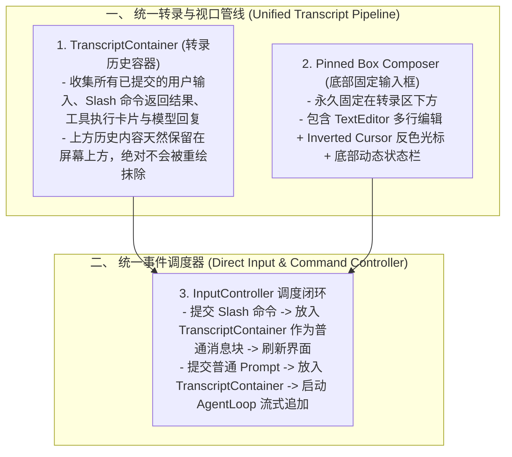

# Problem & Solutions Ledger (Direct Adoption Blueprint)

## 1. Slash 命令完全无法使用的根本原因诊断 (Root Cause of Slash Command Failure)
- **现象**：在终端输入 `/help`、`/model`、`/cost`、`/context` 等命令后没有任何可见反应，命令似乎“失效”了。
- **底层原因剖析**：
  1. **双写冲突与自覆盖（Self-Overwriting Conflict）**：
     - 当用户在 `interactiveLoop.ts` 中按下 Enter 提交 `/help` 时，`routeInteractiveCommand` 确实执行了命令，并通过 `StreamingRenderer` 向终端输出了结果字符串。
     - **但是在 `finally` 块中立即执行了 `redrawTui()`**！
     - `redrawTui()` 中的 `DifferentialTerminalBuffer.render()` 以绝对行号覆盖了屏幕底部行（`topAnchor`）。
     - 结果：刚输出的 Slash 命令结果在不到 1 毫秒的时间内，**直接被重新绘制的空 Box Composer 覆盖抹除了**！用户肉眼根本看不到任何输出！
  2. **缺少转录容器（Transcript Container）进行内容持久承载**：
     - 在成熟架构中，命令输出（`Command Output`）绝不是直接写向底层的 `stdout`，而是作为一条新的 **消息块（Message Block）** 被 `append` 到上方的 `TranscriptContainer` 中。
     - 每次重绘时，`TranscriptContainer` 将已输出的命令结果保持在上方，Box Composer 则在下方继续等待下一次输入，二者井水不犯河水。

---

## 2. 光标跑到最底下、输入输出把输入框冲毁的根本原因诊断 (Screen Destruction)
- **现象**：打字和输出内容从终端最底部冒出来，把画好的圆角框彻底冲散破坏。
- **底层原因剖析**：
  1. **未统一渲染通道（Uncoordinated Direct Writes）**：
     - 当前代码中存在两套冲突的写入机制：一套是 `StreamingRenderer` / `console.log` 的相对流式追加（从光标所在当前行向下写，触碰底行时终端自动向上滚动全屏），另一套是 `DifferentialTerminalBuffer` 的绝对寻址刷屏（`\x1b[row;1H`）。
     - 当两套机制交替写入时，相对写入导致的滚动使整个终端视口的物理行索引全部失效，绝对寻址直接刷在错误的位置，把边框打成碎片。
  2. **缺少两通道帧协调器（Two-Channel Frame Provider: HistoryBatch vs Viewport）**：
     - 成熟架构（OMP）的核心在于 **所有的写入统一收敛至 `TUI` 帧渲染器**：
       - **已完成的历史块（History）**：按行以标准换行追加方式写入滚动条（Scrollback），自然滚动。
       - **当前正在活动的视口（Active Viewport）**：包括未完成的打字框和正在运行的工具卡片，固定在屏幕最底部，用双缓冲差分重绘。

---

## 3. 全量成熟架构直接采用方案 (Direct SOTA Architecture Adoption)

不再搞零散手写逻辑，全面采用成熟架构的标准化三大骨架：

