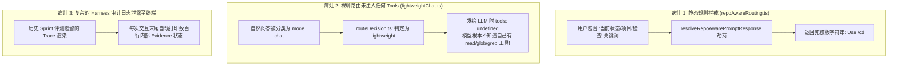

# 项目运行问题分析与缺陷诊断报告 (problem.md)

**记录时间**：2026-08-29  
**测试模型**：`deepseek-ai/DeepSeek-V4-Flash` (SiliconFlow API)  
**测试入口**：`node dist/cli.js` (Interactive Shell Mode)  

---

## 一、 用户真实使用复现与异常现象

### 现象 1：输入“检查一下当前目录下的项目使用的架构是什么”返回了死模板信息
- **用户输入**：
  ```text
  [coding-agents|e7b34612|build] > 检查一下当前目录下的项目使用的架构是什么
  ```
- **实际输出**：
  ```text
  Current working directory: /home/wang/projects/coding-agents
  Project root: /home/wang/projects/coding-agents
  Use /cd <path> (or /workspace attach <path>) to switch target project.
  ```
- **异常原因**：该输入完全**没有被传递给大模型**，而是被底层静态规则直接截胡拦截。

---

### 现象 2：输入“检查一下当前项目使用的架构是什么”，大模型回复“没有访问本地文件的能力”
- **用户输入**：
  ```text
  [coding-agents|e7b34612|build] > 检查一下当前项目使用的架构是什么
  ```
- **大模型输出**：
  > “我目前没有访问你本地文件的能力，因此无法直接检查当前项目的架构。你可以通过以下任一方式提供信息：1. 粘贴关键配置文件... 2. 粘贴项目目录结构...”
- **尾部附加了极长的审计追踪日志**：
  输出尾部自动附加了数百行的 `Continuation`, `context-packet`, `context-graph`, `harness-trace`, `task-lifecycle` 等内部状态转储。

---

## 二、 深度代码级根本原因分析 (Root Cause Analysis)

经过 Serena MCP 对代码链路的端到端逆向分析，明确了以下三大底层病灶：



### 1. 为什么现象 1 被死模板拦截？（病灶 1）
- **代码定位**：`packages/ts-shell/src/core/shell/repoAwareRouting.ts:13-31`
- **机制机理**：系统内置了一个名为 `resolveRepoAwarePromptResponse` 的静态规则拦截器。只要提示词中命中“项目/当前状态/检查”等正则词汇，且没有包含具体文件名，就会被它当作“纯终端本地命令”截胡，直接返回固定字符串，**根本不会发起任何大模型网络请求**！

### 2. 为什么大模型说自己“没有读写文件的能力”？这是幻觉吗？（病灶 2）
- **答：这不是模型的幻觉，模型说的是大实话——因为系统发请求给它时，压根没有给它挂载任何工具！**
- **代码定位**：
  - `packages/ts-shell/src/core/query/routeDecision.ts`
  - `packages/ts-shell/src/core/query/lightweightChat.ts`
- **机制机理**：
  - 当你问“检查项目架构”时，`routeDecision.ts` 将其归类为 `mode: "chat"` 并路由到 `lightweightChat.ts`。
  - `lightweightChat.ts` 在向大模型 API（`/v1/chat/completions`）发起请求时，传递的参数仅有 `messages: [...]`，**`tools` 字段完全为空（`undefined`）**！
  - 模型在没有任何 Tool Calling 定义（没有 `read`, `glob`, `grep` 等 function schema）的情况下，只能像裸聊网页版 ChatGPT 一样，如实回答“我没有本地文件访问权限，请把代码贴给我”。

### 3. 为什么尾部会打印长达数百行的参数转储？（病灶 3）
- **代码定位**：`packages/ts-shell/src/presentation/surface/model.ts` 与 `cliDisplayProjection.ts`
- **机制机理**：这是历史 Sprint 做评测和形式化证明（Harness Trace）时遗留的调试信息导出逻辑。系统在单轮结束后，默认将内部状态机、证据账本（Evidence Ledger）、生命周期阶段全部 dump 到了终端，没有做面向最终用户的洁净展示过滤。

---

## 三、 问题汇总与整改目标清单

| 问题编号 | 严重级别 | 问题描述 | 核心整改方向 |
| :--- | :---: | :--- | :--- |
| **BUG-01** | **Blocker** | `repoAwareRouting.ts` 静态劫持自然语言提问 | **彻底废除/移除** `resolveRepoAwarePromptResponse` 静态正则拦截，所有自然语言提问必须直通模型。 |
| **BUG-02** | **Blocker** | 普通对话与问答未向大模型提供基础工具 (Toolless) | **全量挂载标准 Tools**：无论任何问答模式，统一向模型注入 `read`, `glob`, `grep`, `bash`, `write`, `edit` 工具定义，使模型可自主调用工具探索项目。 |
| **BUG-03** | **Major** | 终端输出泄露冗长的内部 Harness 审计状态机 | **终端输出洁净化**：普通交互模式下默认仅渲染模型的正文回答与工具卡片，隐藏底层内部 Debug Trace。 |
| **BUG-04** | **Major** | 缺乏标准 ReAct 自动工具循环（Tool Calling Loop） | 实现当模型触发 `tool_calls` 时，自动执行工具并将结果回传模型，直至生成最终结论。 |

---

## 四、 专项反思：为什么“通用对话（lightweightChat）”在 Agent 中毫无存在必要？

### 1. 它最初为什么被设计出来？（历史诱因）
- **省 Token / 省费用**：早期设计者认为用户问“你好”或基础概念时，请求体带上几千 Token 的 Tool Schemas 纯属浪费，于是做了个不带工具的裸聊通道。
- **绕开旧编排的重重门禁**：因为旧的 `workflowExecutionCoordinator` 静态门禁极严（稍微缺少精准行号或字符就直接抛出 `ambiguous-target` 并强行阻断），设计者为了让普通聊天能跑通，开辟了一条不走编排的旁路。

### 2. 为什么在真实 Agent 中它完全是负资产？（致命弊端）
1. **静态正则永远无法猜透人类自然语言的意图**：
   - 用户问：`“检查一下当前项目使用的架构是什么”`。
   - 静态路由（`routeDecision.ts`）因为没看到具体文件名，强行归类为 `mode: "chat"` 并打入 `lightweightChat`。
   - 结果：模型因为请求中没有挂载 `read/glob/grep` 工具定义，只能如实回答“我没有读取本地文件的权限”。
2. **现代 LLM 本身具备极高成熟度的 Tool-Calling 自治决策能力**：
   - 在 **Pi** 和 **Claude Code** 等顶尖开源项目中，**根本不存在割裂的“聊天模式”与“编码模式”**。
   - 系统发给模型的每个 Turn 永远配备全套工具定义：
     - 用户问 `“你好”` 时，模型自主选择**直接回复文本**（不发起 Tool Call）；
     - 用户问 `“当前项目用的什么框架”` 时，模型自主发起 `read package.json` 或 `glob` 工具，读完再回答。
   - 用死板的外部正则去替模型做主，不仅容易误判，更是彻底废掉了 Agent 的自主性。

### 3. 清算与重构定论
- **彻底废除 `lightweightChat.ts` 及其上游 `routeDecision.ts`**。
- 全面收敛为**统一的标准 ReAct Agent Loop**（永远挂载标准 Tools，由大模型自主决策调用工具或直接回答）。
